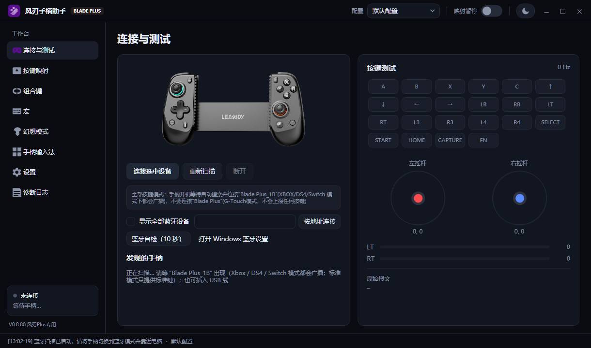
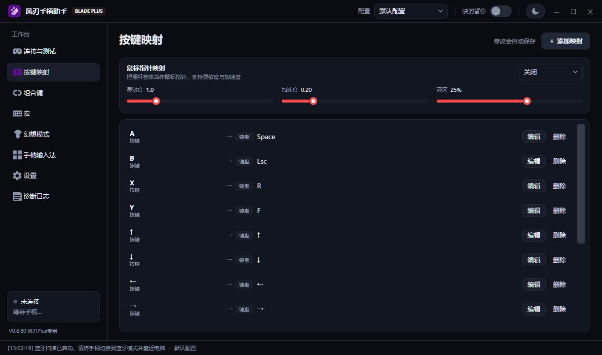
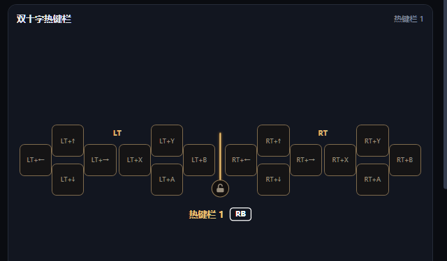
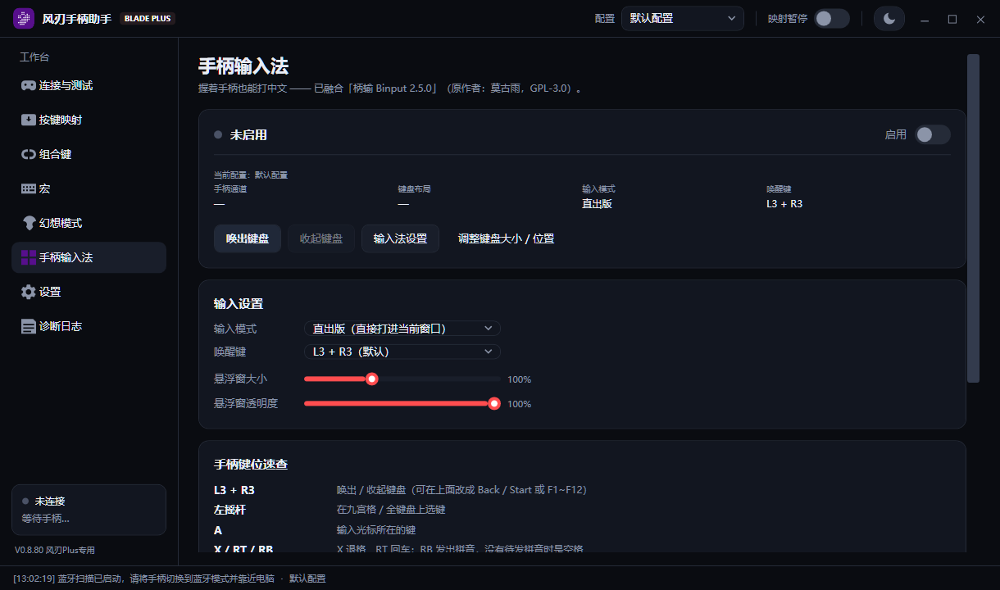

<div align="center">


# 风刃手柄助手

**把 Leadjoy 风刃 Plus 变成你的专属键鼠、宏键盘和中文输入法**

[](CHANGELOG.md)
[](#系统要求)
[](https://dotnet.microsoft.com/)
[](LICENSE)
[](#声明)

[下载](#下载与安装) · [快速上手](#5-分钟上手) · [完整说明](docs/使用说明.md) · [PDF 版](docs/使用说明.pdf) · [常见问题](#常见问题)

</div>

---

## 这是什么

**风刃手柄助手（Leadjoy Blade Assistant）** 是一款面向 **动感指尖 / Leadjoy 风刃 Plus（Blade Plus）** 的 Windows 手柄增强工具。

它通过手柄的 `0x8650` 厂商蓝牙通道读取 **32 位按键位图**，把风刃上的 23 个实际按键和 8 个摇杆方向映射成键盘、鼠标、文本或宏；并在此基础上提供三套进阶玩法：

- **幻想模式** — 双十字热键栏，8 套 × 16 格，像 MMO 手柄一样玩；
- **系统菜单** — 贯穿屏幕的横向指令带，键盘 / 手柄 / 鼠标 / 宏 / 文本动作一键触发；
- **手柄输入法** — 融合开源项目「柄输 Binput 2.5.0」，握着手柄直接打中文。

软件为 **单文件绿色版**：解压即用，不写注册表（除可选的开机启动），**不需要安装 .NET 运行时**，所有配置都保存在 exe 同目录。

> 本项目与动感指尖 / Leadjoy 官方无关，协议来自对官方 App 的分析；使用前请阅读[免责声明](#声明)。

---

## 功能亮点

| 模块 | 能做什么 |
| --- | --- |
| **按键映射** | 23 个按键 + 8 个摇杆方向 → 键盘（可加 Ctrl/Alt/Shift/Win）、文本、鼠标按键、滚轮、宏、屏蔽；支持连发、按一下切换、固定鼠标位置 |
| **组合键** | 2 个以上手柄键同时按下触发一个动作，45 ms 防误触窗口；可从手柄直接捕获 |
| **宏** | 键盘 / 手柄 / 鼠标 / 文本 / 延迟步骤自由混排，支持录制、拖拽排序、多选复制粘贴、固定鼠标位置 |
| **摇杆当鼠标** | 左或右摇杆整体控制指针，灵敏度、加速度、死区可调 |
| **幻想模式** | 8 套双十字热键栏 × 16 格；17 个基础键位；悬浮窗可缩放 / 调透明度 / 锁定 / 拖到任意显示器；LT+RT 扩展页；RB 点按切栏、长按选栏 |
| **系统菜单** | 顶部横向菜单栏 + 纵向项目列表；键盘 / 手柄 / 鼠标点击 / 独立宏 / 文本五种动作；鼠标位置按窗口或显示器百分比记录，分辨率变化不点错 |
| **手柄输入法** | 九键拼音 / 全键盘、预输入 / 直出、主题皮肤、双拼、滑行输入、快捷短语；风刃已连接时直接使用风刃解析的手柄状态 |
| **多配置** | 按前台程序自动切换配置（如不同游戏各一套），支持 JSON 导入 / 导出 |
| **连接与测试** | 自动发现并连接，实时显示按键、摇杆、扳机、原始报文与上报频率 |

### 界面预览

| 连接与测试 | 按键映射 |
| :---: | :---: |
|  |  |

## 三套进阶玩法

### 幻想模式 · 双十字热键栏



8 套 × 16 格；LT / RT + 方向键或 ABXY 触发，RB 点按切栏、长按选栏；悬浮窗可缩放、调透明度、锁定和跨屏拖动。[详细说明 →](docs/使用说明.md#9-幻想模式)

### 系统菜单 · 横向指令带


SELECT 呼出，方向键切换菜单栏与项目；键盘 / 手柄 / 鼠标点击 / 文本 / 独立宏五种动作，鼠标位置按窗口或显示器百分比记录。[详细说明 →](docs/使用说明.md#10-系统菜单)

### 手柄输入法 · 用手柄打中文



九键拼音 / 全键盘；预输入 / 直出两种模式；L3 + R3 唤出，支持主题皮肤、双拼、滑行与快捷短语。[详细说明 →](docs/使用说明.md#11-手柄输入法)

> 更多截图（组合键、宏、设置、诊断日志）见 [docs/images](docs/images)。

---

## 系统要求

| 项目 | 要求 |
| --- | --- |
| 操作系统 | Windows 10 2004（19041）及以上 / Windows 11，**x64** |
| 运行库 | **无需安装** .NET（发布版为 self-contained 单文件） |
| 连接 | 蓝牙 4.0+（BLE）或 USB 数据线 |
| 权限 | 普通权限即可；目标游戏以管理员运行时，本程序也需以管理员运行 |

---

## 下载与安装

1. 打开本仓库的 [Releases](../../releases/latest) 页面；
2. 下载最新版，二选一：
   - **`LeadjoyBlade-V0.8.81-win-x64-clean.zip`**：初始空配置，无按键映射、无组合键、无宏 / 幻想库预设；
   - **`LeadjoyBlade-V0.8.81-win-x64-sample.zip`**：含示例配置（以《冒险岛》NewMaple 神射手为参考，供配置参考）；
3. 解压到任意可写目录（不要放在 `C:\Program Files` 等需要管理员权限的目录，否则配置会写到 `%AppData%`）；
4. 双击 `LeadjoyBlade.exe`。

首次运行若 Windows 提示「已保护你的电脑」，点 **更多信息 → 仍要运行**（未签名的开源程序常见提示）。

> 便携设计：`settings.json`、`profiles\`、`fantasy-library.json`、`macro-library.json`、`logs\`、`save\` 都生成在 exe 同目录。想彻底重置，退出程序后删掉这些文件和目录即可。

离线阅读：[使用说明 PDF](docs/使用说明.pdf)（A4 排版，适合打印 / 传阅）｜ [Word 版](docs/使用说明.docx)

---

## 5 分钟上手

### 第 1 步：先运行程序

双击 `LeadjoyBlade.exe`。首次启动只有「默认配置」，映射默认暂停。

### 第 2 步：手柄开机并连接

1. 手柄开机，切到 **XBOX / DS4 / Switch** 任一模式；
2. 通过蓝牙或 USB 与 PC 连接：
   - **蓝牙**：Windows **设置 → 蓝牙和其他设备 → 添加设备**，选择手柄；
   - **USB**：直接用数据线连接；
3. 连接成功后，程序会通过厂商通道识别到 **`Blade Plus_1B`** 并**自动连接**；没有自动连就点 **重新扫描**。

> `Blade Plus_1B` 是程序内部识别到的厂商通道名，**不会出现在 Windows 蓝牙配对列表里**；在 Windows 里正常连接手柄即可。
>
> **蓝牙兼容性提示**：蓝牙 5.2 及更早版本可能与手柄厂商通道存在兼容性问题。如果 `Blade Plus_1B` 没有自动连接成功，可以尝试重启手柄；推荐使用瑞昱蓝牙 5.4 适配器或 USB 连接，适配更稳定、更快速。

### 第 3 步：开始映射

1. 进入 **按键映射** → 右上角 **＋ 添加映射**；
2. 选择手柄按键（或点 **捕获按键** 后直接按手柄）；
3. 选择动作类型（键盘按键 / 输入文本 / 鼠标按键 / 鼠标滚轮 / 宏 / 不映射）；
4. 保存即生效，修改会自动写入配置。

### 第 4 步（可选）：打开幻想模式

进入 **幻想模式** → 右上角开关启用 → 按手柄 **RB** 切栏、**LT/RT + 十字或 ABXY** 触发格子。

### 第 5 步（可选）：打开手柄输入法

进入 **手柄输入法** → 打开 **启用** → 按 **L3 + R3** 唤出悬浮键盘 → 左摇杆选键、**A** 输入、**RB** 发拼音、**RT** 回车。

---

## 功能详解

### 按键映射

- **动作类型**：键盘按键（含修饰键）、输入文本（支持中文）、鼠标按键（左/右/中/侧键 1/2）、鼠标滚轮、宏、不映射。
- **连发**：按住期间按设定间隔循环触发，间隔 15–2000 ms。
- **切换**：按一下保持按下，再按一下松开，适合自动奔跑、持续开镜。
- **摇杆斜向**：只需映射上下左右四个方向，推到斜向时会同时按下两个方向键（如 ↑ + →），不用单独配八个方向。
- **固定鼠标位置**：鼠标按键 / 滚轮可记录一个相对游戏窗口或显示器的百分比坐标，窗口移动、改分辨率后仍点在同一位置。

### 组合键

- 勾选 2 个以上按键，或点 **从手柄捕获** 后同时按住组合键 3 秒自动识别；
- 防误触窗口 45 ms：先按下的键会等 45 ms，凑齐组合就不再触发单键动作；
- 建议不要给组合键的首键再单独配单键动作，避免误触。

### 宏

- 步骤类型：键盘、手柄、鼠标、文本、延迟；
- **录制**：点「● 开始录制」后直接敲键盘 / 按手柄，自动记录按键与间隔，Esc 停止；
- **编辑**：拖动行首 ☰ 排序，Ctrl / Shift 多选，Ctrl+C / X / V 复制剪切粘贴，双击文本步骤改文字；
- 宏可以被按键映射、幻想模式和系统菜单共同调用。

### 幻想模式

- 8 套热键栏，每套 16 格（LT 半区 8 格 + RT 半区 8 格）；
- **RB 点按** 切到下一个可见热键栏，**长按 RB** 打开选择条（Y/B/A/X/↑/→/↓/← 直选 1–8）；
- 固定组合：`LT + R3` 鼠标左键、`RT + R3` 鼠标右键、`RB + R3` 切灵敏度、单按 `R3` 切滚轮、`LT + SELECT` 显示/隐藏悬浮窗；
- 悬浮窗支持 10%–150% 缩放、0–100% 透明度、锁定 / 拖动、多显示器；
- 17 个基础键位：A/B/X/Y、十字键、LB、L4、R4、SELECT、START、CAPTURE、C、L3、Fn。

### 系统菜单

- 在幻想模式页启用，默认 **SELECT** 呼出；
- 方向键导航（到边界停住，不回绕），确认键执行并关闭，取消键直接关闭；
- 五种动作：**键盘按键 / 手柄按键 / 鼠标点击 / 文本输入 / 独立宏**；
- 鼠标点击坐标按「目标进程客户区百分比」记录，未配置进程时按显示器百分比记录，多屏不点错；
- 菜单打开期间方向键与确认/取消键不再映射到键盘，其他按键保持原映射。

### 手柄输入法

- 基于 [柄输 Binput 2.5.0](https://github.com/moguyu-binput/Binput)（GPL-3.0），源码已整体编入本程序，**不需要单独运行 Binput**；
- **预输入版**（推荐）：带预览框，打完一段整段粘贴，游戏不会吃到半截按键；**直出版**：不抢焦点，直接输入当前窗口；
- 唤醒键默认 `L3 + R3`，可改为 Back / Start / Back+Start / L3 / R3 或键盘 F1–F12；
- 输入法唤出期间风刃映射自动暂停，收起后恢复；
- 悬浮窗支持 60%–180% 大小、20%–100% 透明度、锁定与跨屏拖动。

---

## 支持的设备与模式

| 模式 | Windows 里怎么连 | 程序内通道 | 可读按键 |
| --- | --- | --- | --- |
| **XBOX / DS4 / Switch** | 正常蓝牙配对或 USB | `Blade Plus_1B`（厂商通道） | 全部 23 键 + 摇杆/扳机 |
| 风刃 G-Touch | 仅屏幕映射 | — | 不上报按键 |
| 风刃 USB 有线 | 直接插数据线 | 视固件而定 | 部分固件只提供标准键 |
| DualShock 4 | 正常蓝牙配对 | HID | 标准键 |
| DualSense / Edge | 正常蓝牙配对 | HID 直读 | 标准键 + 触摸板 |
| Switch Pro / 风刃 Switch 模式 | 正常蓝牙配对 | HID 手柄 | 标准键（LT/RT 为数字量） |
| Xbox 手柄 / 2.4G 接收器 | 正常配对 | XInput | 标准键，**读不到** Fn / 背键 |

> 只有程序内识别到的 `Blade Plus_1B` 厂商通道能读取风刃的 Fn、L4/R4、C/Z、Capture 等扩展键；标准 HID / XInput 只能读标准键。

---

## 数据与隐私

- 程序**不联网**、不上传任何数据，全部配置和日志都在本地；
- 数据目录 = exe 所在目录；若不可写则自动回退到 `%AppData%\LeadjoyBlade`；
- 主要文件：

| 文件 | 内容 |
| --- | --- |
| `settings.json` | 应用设置（主题、启动、托盘、自动切换） |
| `profiles\*.json` | 每个配置的按键映射、组合键、幻想模式、摇杆参数、输入法开关 |
| `fantasy-library.json` | 幻想模式标签组与映射库 |
| `macro-library.json` | 全局宏库 |
| `save\Binput.save` | 手柄输入法存档（DPAPI 加密） |
| `logs\`、`startup.log`、`crash.log` | 诊断日志 |

分享配置时只发 `profiles\*.json` 即可；日志可能包含设备名，公开前请自行检查。

---

## 常见问题

<details>
<summary><b>找不到手柄，或连接后按键没反应</b></summary>

1. 确认手柄处于 **XBOX / DS4 / Switch** 模式，并已在 Windows 里连接（`Blade Plus_1B` 只在程序内显示）；
2. 关闭手机上的官方 App（蓝牙同一时间只能被一个主机占用）；
3. 在 Windows 蓝牙设置里删除旧的手柄记录，重新配对；
4. 点「重新扫描」，或直接用 USB 线连接；
5. 打开「诊断日志」看 `logs\ble.log` 里的扫描与连接记录。
</details>

<details>
<summary><b>游戏里按键无效</b></summary>

- 部分游戏使用独占 Raw Input 或反作弊保护，会忽略 `SendInput` 注入；
- 尝试右键程序 **以管理员身份运行**（游戏是管理员时，本程序也必须是）；
- 先在记事本里测试映射能否输出字符，确认注入链路正常。
</details>

<details>
<summary><b>用 Steam 启动的游戏，映射错乱 / 手柄被抢</b></summary>

Steam 自带手柄支持，会和本程序抢手柄、重复注入。建议给 Steam 快捷方式禁用 Steam 手柄支持：

1. 右键 Steam 快捷方式 → **属性**；
2. 在「目标」末尾加一个空格，追加 `-nojoy`，例如：

   ```
   "C:\Program Files (x86)\Steam\steam.exe" -nojoy
   ```

3. 保存后，先退出已运行的 Steam，再用这个快捷方式启动 Steam。

只对通过该快捷方式启动的 Steam 生效；也可以在 Steam「设置 → 控制器 → Steam 输入」里直接禁用。
</details>

<details>
<summary><b>手柄输入法唤不出 / 打不出字</b></summary>

- 确认页面右上角「启用」已打开，且「手柄通道」不是「未检测到手柄」；
- 游戏以管理员运行时，本程序也要以管理员运行；
- 直出版打中文前，目标窗口需要先切到中文输入法；游戏里建议用 **预输入版**；
- 详见 [手柄输入法说明](docs/INPUT-METHOD.md)。
</details>

<details>
<summary><b>摇杆方向相反 / 有虚位</b></summary>

- 设置 → 摇杆与扳机，勾选「反转左/右摇杆 Y 轴」；
- 调大摇杆死区；若物理推到底仍不到边缘，通常是手柄传感器提前饱和，软件无法恢复。
</details>

<details>
<summary><b>会封号吗？</b></summary>

- 本程序只做键鼠注入，不读写游戏内存、不修改游戏文件；
- 但部分反作弊系统会拦截任何注入类工具，**风险请自行判断**，建议先在小号或单机环境测试。
</details>

更多问题见 [完整使用说明 · 常见问题](docs/使用说明.md#15-常见问题)。

---

## 从源码构建

需要 **.NET 8 SDK**（Windows）与 Git：

```powershell
git clone <本仓库地址>
cd leadjoy

# 构建主程序（单文件、自包含）
dotnet publish src/LeadjoyBlade.App/LeadjoyBlade.App.csproj `
  -c Release -r win-x64 --self-contained true `
  -p:PublishSingleFile=true `
  -p:IncludeNativeLibrariesForSelfExtract=true `
  -p:EnableCompressionInSingleFile=true `
  -o build/app
```

产物为 `build/app/LeadjoyBlade.exe`（约 80 MB）。开发时也可以直接 `dotnet build src/LeadjoyBlade.sln`。

> 构建会还原 NuGet 包（HidSharp）；首次构建需要联网。手柄输入法模块不依赖任何 NuGet。

---

## 项目结构

```
leadjoy/
├─ src/
│  ├─ LeadjoyBlade.App/      WPF 界面、幻想模式、系统菜单、输入注入
│  ├─ LeadjoyBlade.Core/     协议、设备传输、映射引擎、配置
│  ├─ LeadjoyBlade.Binput/   融合的「柄输 Binput 2.5.0」源码
│  ├─ LeadjoyBlade.Probe/    独立的硬件探测工具
│  └─ LeadjoyBlade.SelfTest/ 自检程序
├─ docs/                     使用说明、协议、专题文档与截图
├─ assets/                   图标与手柄素材（在 App/Assets 内）
└─ LICENSE / THIRD-PARTY-NOTICES.md
```

技术细节见 [PROTOCOL.md](docs/PROTOCOL.md)（协议）、[SYSTEM-MENU.md](docs/SYSTEM-MENU.md)（系统菜单设计）、[INPUT-METHOD.md](docs/INPUT-METHOD.md)（输入法）。

---

## 参与贡献

欢迎提交 Issue 和 Pull Request：复现步骤、日志、手柄型号与连接方式越完整，越容易定位问题。提交前请阅读 [CONTRIBUTING.md](CONTRIBUTING.md)。

---

## 致谢与许可

- **柄输 Binput 2.5.0** — 作者 **莫古雨**，[GitHub](https://github.com/moguyu-binput/Binput)，GPL-3.0；
- **rime/rime-essay** — 拼音词库上游，LGPL-3.0；
- **HidSharp** — Apache-2.0，HID 直读；
- **.NET 8 / WPF** — MIT。

本项目因包含 GPL-3.0 的 Binput 源码，**整体以 [GPL-3.0](LICENSE) 分发**。第三方组件与修改说明见 [THIRD-PARTY-NOTICES.md](THIRD-PARTY-NOTICES.md)。

### 声明

- 本程序由 **Yure5（幻色）** 开发，仅供学习与个人使用，完全免费、无广告，谨防收费诈骗；
- 使用本程序造成的账号风险、设备问题或数据损失，由使用者自行承担。
