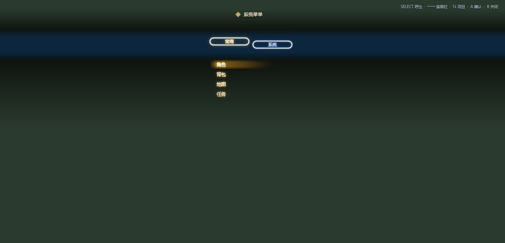
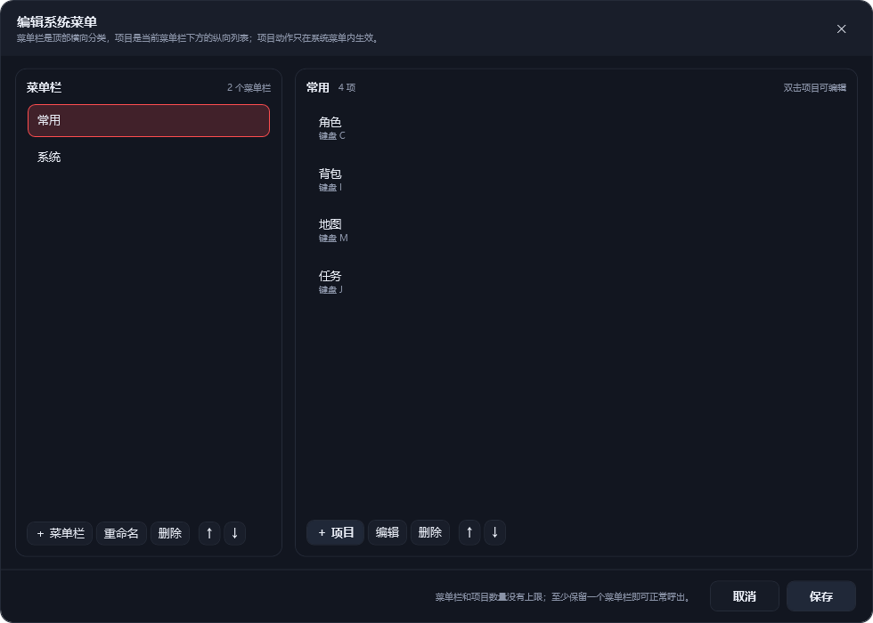
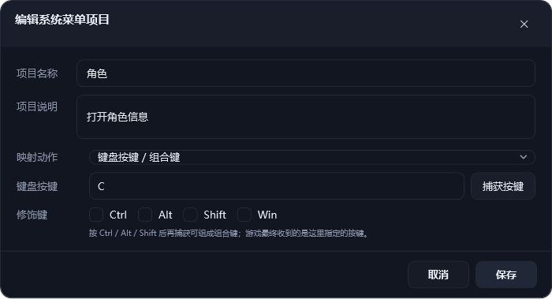

# 系统菜单（V0.8.81）

> 交互参考：B 站《【FF14】莫古雨的手柄完全教程》7:22–7:30 的系统菜单画面  
> 顶部横向菜单栏 + 当前菜单栏下方的纵向项目列表，方向键移动、确认键选取。



## 1. 入口

幻想模式页「基础键位」下方的「系统菜单」卡片：

- 启用系统菜单；
- 呼出键：`SELECT`（默认）或 `START`；
- 确认键：`A`（默认）/ `B` / `X` / `Y`；
- 取消键：`B`（默认）/ `A` / `X` / `Y`，不能与确认键相同；
- 「编辑菜单与项目…」打开菜单编辑器。


## 2. 打开菜单时的按键规则

| 输入 | 行为 |
|---|---|
| 呼出键（SELECT/START） | 打开/收起系统菜单；启用系统菜单后该键不再执行原基础键映射 |
| 十字键 ← → | 切换菜单栏（循环） |
| 十字键 ↑ ↓ | 在当前菜单栏内选择项目（循环） |
| 确认键 | 执行当前项目并关闭菜单 |
| 取消键 | 关闭菜单，不执行项目 |
| 其他按键 | 保持原幻想模式映射 |
| ABXY 同时按下两个及以上 | 视为手柄组合键，不触发菜单确认/取消，仍按原映射处理 |

- 方向键按住约 340ms 后开始连续移动，间隔 90ms。
- 项目列表整体上移一行，第一行藏在蓝条后；选中框固定在项目列表第二行，并贴近蓝条下沿。
- 选中框左边缘与当前菜单栏按钮左边缘对齐，项目文字再向右缩进。
- 向下选择时项目列表整体上滑，选中框本身不移动。
- 列表图层位于蓝条后面，上滑时会穿过后面的半透明蓝条，并在蓝条上边缘/上方黑影处隐去。
- 项目文字在黄色选中框和每一行内上下居中；标签内文字水平、垂直都居中。
- 参考视频：标签是较小的深蓝胶囊，选中项用金色描边+浅色文字，不使用大面积金色填充。
- 蓝条内部使用统一颜色，只对上下边缘做透明度柔化；上下阴影合并为一整块垫在蓝条下层，下方延伸更长。
- 项目列表从蓝条后方向上穿过；选中框是 85% 宽的圆角矩形，左实右淡，带细金边和柔和投影。
- V0.3.2 数值：蓝条高度 44→53（+20%）；阴影透明度 40%→52%（#85）、20%→26%（#42）；选中标签上浮 4→5px（约 +20%）；项目列表/选中框上移 12.5px（半行）。
- V0.3.3 数值：阴影 52%→67.6%（#85→#AD）、26%→33.8%（#42→#56）；选中标签上浮 5→10px；标签最小宽度 84/80→101/96（+20%），水平内边距 13→15.6（+20%），标签间距 6→11px（+5px）。
- V0.3.4 数值：阴影主透明度 60%（#99）、次透明度 36%（#5C）；选中标签上浮 -8px；标签间距 8px；蓝条上下各 30% 高度做透明度柔化；选中框径向遮罩中心（35%,50%）、RadiusX 88%、RadiusY 72%、实体区到 30% 后开始淡出。
- V0.3.5 数值：阴影主透明度 65%（#A6）、次透明度 40%（#66）；蓝条上下各 25% 高度做柔化（53×25%≈13.25px/边）；文字/标签框增加白色内发光；金色外发光扩大；选中标签上浮过渡 170ms，项目框展开动画 380ms。
- V0.3.6 调整：标签上浮动画 170→110ms，且只在**切换标签栏**时播放；同标签内换项目、菜单首次呼出都不播放。项目框展开 380→300ms。文字白色内发光层 28%→40%，白晕 2.2px/65%→2.8px/75%。标签边框金色外发光 8px/30%→10px/40%，选中 7px/12%→9px/30%。
- V0.3.7 调整：选中/未选中标签尺寸统一为最小宽度 101px；外发光范围统一，只切换颜色（未选中蓝、选中黄）。项目框径向遮罩中心从 (35%,50%) 右移到 (42%,50%)，仅加重左侧柔化，保持矩形比例。
- V0.3.8 调整：标签上浮 80→50ms；标签框外发光 14px/60%，标签文字/项目文字外发光 8px/60%；取消选中标签的黄色底色填充，选中只改变边框/文字/发光颜色；项目列表顶部在蓝条上沿以上 10px 内用透明度渐变隐去。
- V0.3.9 调整：项目栏顶部透明渐变整体下移 5px，裁剪上界 11→16px。
- V0.4.0 调整：顶部渐隐加长到 28px 并使用缓动曲线；项目列表滚动动画延长；标签框/文字外发光增强。
- V0.4.1 调整：渐隐带改为 20px 多段缓动；滚动动画 220ms（CubicEase）；标签框白色内发光 5px/70%，文字白色层 55%、白晕 3.6px/85%；标签内部使用不透明深蓝底 `#E60A2B48`，彻底去掉选中黄底。渐隐区域图示见 `docs\system-menu-fade-diagram.png`。
- V0.4.2 调整：标签上浮 50→35ms；渐隐带加宽；标签框外发光 18px/75%→16px/70%。
- V0.4.3 调整：标签框内部改为**完全透明**（项目文字可穿过）；顶部渐隐改为 21px 全在蓝条上方；黑影总高 200px；文字白色内发光增强。
- V0.4.4 调整：修复渐隐不生效——首次显示/布局完成后重新应用 `OpacityMask`；裁切上沿改为动态取 **TitleText 文字下沿**；文字白色内发光层 72%→85%，白晕 4.2/90%→5/95%。
- V0.4.5 调整：渐隐终点从蓝条上沿改为**蓝条中心 y=47.5px**（蓝条 21–74px），标题文字下沿透明 → 蓝条中心完全不透明，渐变带宽约 47.5px。
- V0.4.6 修复：把 `OpacityMask` 从 `Canvas` 移到带透明背景的 `ItemsMaskHost` 容器上。此前 `Canvas` 的内容边界会导致遮罩映射失效，所以运行时完全没有渐变；现在遮罩按整个项目区域正确映射。渐隐仍为标题下沿 0% → 蓝条中心 47.5px 100%。
- V0.4.7 修复：系统菜单只占用单键。LT/RT 按住时菜单不接收热键、方向键、确认/取消，组合键交还原映射/悬浮窗快捷键；`LT+SELECT` 始终切换悬浮窗，不再被 SELECT 单键热键吞掉；`RT+ABXY` 等组合恢复为扩展/原映射。
- V0.5.0 修复：菜单打开时不再无条件跳过 `AnimateActiveSlots`。现在只在“菜单接管单键”时跳过；按住 LT/RT 的组合键仍会播放悬浮窗按键动画，动作与动画保持一致。
- V0.5.1 布局：系统菜单悬浮窗整体下移 60px（在原有自动顶部偏移基础上加 60）。
- V0.5.2 布局：蓝条 85px（y=50–135），黑影总高 300px（上方 50、下方 165）；项目列表下移到 y=110，选中框 y=135；渐隐终点改为蓝条中心 92.5px；标签边框 2px、内白边 2px 纯白；菜单/项目文字白色内层 100%。
- V0.5.3 回退：移除 V0.5.2 新增的项目栏上下展开动画，恢复 V0.5.1 的项目列表切换行为；选中框柔化恢复为 V0.5.1 参数。
- V0.5.4 修复：项目上下导航改为边界停住，不再从第一项向上回绕到最后一项（或从最后一项向下回绕到第一项）。
- V0.5.5 修复：Switch 模式 16 位摇杆 Y 轴取反溢出，向上推到顶不再跳到底。
- V0.5.6 修复：对齐 V0.1.8 摇杆逻辑，移除 Switch 解析层对 X/Y 单轴分别扣 96/800 的死区。旧逻辑只由运行时按整体半径 `sqrt(x²+y²)` 判断死区；单轴死区会把斜向轻推的两个轴同时归零，导致四个斜方向无反应。
- V0.5.7 测试图：尝试方形线性映射。
- V0.5.8 测试图修正：恢复圆形轨迹，并在原始 X/Y 后增加 4 位小数归一化坐标。
- V0.5.9 测试图范围：左右测试圆由 112→180px，满偏行程 42→72px。
- V0.6.0 修复：Switch 0x3F 的 16 位轴不再乘 2。原来 `(raw-0x8000)*2` 会在摇杆走到一半时撞上 ±32767 并截断，后半程报文仍变化但输出不动；现在 0x0000–0xFFFF 完整映射到 -32768..32767。
- V0.6.1 样式：摇杆测试区恢复为 112px、满偏行程 42px、原始整数坐标显示；保留 V0.6.0 的 16 位轴修复。
- V0.6.2 样式：项目选中底框去掉 1px 描边，只保留渐变填充和径向柔化，消除边缘细线。
- V0.6.3 样式：选中底框径向羽化加大，左侧轻微减淡。
- V0.6.4 样式：尝试横向/纵向双层遮罩。
- V0.6.5 修正：撤回双层遮罩，恢复单层径向遮罩。
- V0.6.6 样式：径向遮罩改为多段缓出。
- V0.6.7 修正：尝试带 alpha 的径向金色填充。
- V0.6.8 回退：项目框恢复 V0.6.2 样式——横向金色渐变、径向遮罩 (42%,50%)/RadiusX 88%/RadiusY 72%/实体区 30%、无描边。
- V0.6.9 左端过渡：横向渐变最左端改为 0–10%，0% 完全透明，10% 变为实体。
- V0.7.0 上下过渡：纵向线性遮罩，最上/下端 0–5%。
- V0.7.1 回退：恢复 V0.6.9 的横向渐变和单层径向柔化；仅把径向 RadiusY 由 72% 收到 62%，让右侧拖尾上下稍微收窄，长度不变。
- V0.7.2 羽化：径向实体区 30%→38%，上下羽化范围略缩小。
- V0.7.3 颜色：按参考图把项目框改成更深的琥珀金，主体 `#9C701C`、尾部 `#7A5512`，右端残留透明度收到 4%。
- V0.7.4 交互：标签上浮 100ms；移除文字内发光副本；鼠标点击关闭菜单。
- V0.7.5 文字：改为白色字芯。
- V0.7.6 文字：白字下增加 4 向 1px 金色描边。
- V0.7.7 文字：去掉硬描边，改为金色柔光。
- V0.7.8 文字：白字下增加模糊金色字缘，外发光 16px。
- V0.7.9 文字：金色范围收紧——字缘 Blur 2.2→1.2，外发光 16→10px；金色提亮为 `#FFD76A`，选中用 `#FFE08A`。
- V0.8.0 鼠标：去掉轮询，菜单窗口改用 `PreviewMouseDown` 退出。
- V0.8.1 鼠标：菜单窗口只有 1280×640，窗口外点击收不到。新增 `SystemMenuClickCatcher` 全屏透明捕获层（虚拟屏幕大小，`PreviewMouseDown` 退出），菜单保持穿透；菜单打开期间任意鼠标点击（包括双十字热键栏）都直接退出菜单。
- V0.8.2 导航：`MoveSelection` 返回是否真的改变；到达列表边界后继续按上/下不再调用 `PushOverlay`，选中框动画、列表滚动和标签上浮都不重播。
- V0.8.3 布局：蓝条高度 85→78（上下 25% 柔边、选中框贴条下沿、列表渐隐终点随 `BandHeight` 同步）；项目列表起点改由 `ListTop` 常量统一驱动（`Canvas.Top=103`），不再写死 110；顶部「系统菜单」标题行下移 20px（y 9→29），标题行整体置于黑色阴影上层（`Panel.ZIndex=10`），标题下沿 44.24 成为项目列表渐隐上沿。右上角提示行仍在原位（y≈10.59）。
- V0.8.4 修复：每次呼出都重放 120ms 淡入。原因：`Root.Opacity` 的淡入动画默认 `FillBehavior.HoldEnd` 停在 1，第二次 `ShowMenu` 的 `Root.Opacity = 0` 被旧动画覆盖，新动画从 1→1，表现为「只有第一次有出现动画」；现在先 `BeginAnimation(OpacityProperty, null)` 清掉旧动画，再显式 `0→1`。
- V0.8.29 版式：指定进程、悬浮窗不越界时，黑影顶部最外侧不再从 0% 开始，而是保留约 8% 不透明度（`#14`），再平滑升到蓝条顶部的 `#A6`；渐隐仍完全在窗口内，但最外侧不会再出现“先透明一段、然后突然变黑”的观感。\n- V0.8.28 修复：指定进程时悬浮窗严格限制在进程窗口客户区内，不再向上延伸；黑影顶部渐变恢复为窗口内的 74px（不越过窗口边界）。未配置进程时仍按工作区计算。\n- V0.8.27 版式：菜单悬浮窗向上延伸最多 200px（不超过进程窗口上方的屏幕空间），内容整体下移同样距离、蓝条屏幕位置不变；黑影顶部渐隐长度变为 74+延伸 像素（最多约 274px），并随窗口高度重新计算渐隐色标；窗口高度仍按目标窗口/工作区计算，底部衰减保持 368px。\n- V0.8.26 版式：向上阴影改为与向下同样的“长渐隐”处理——从窗口上沿 0 一直渐变到蓝条顶部（74px，10 个色标），不再提前进入 `#A6` 实体区；阴影总高保持 520，向下衰减不变。\n- V0.8.25 版式：黑影 460 → **520**，向上实体区提前到窗口 y≈44（比蓝条顶高约 30px），顶部渐隐改为 7 段、底部 9 段，共 17 个色标，过渡更柔和。\n- V0.8.24 版式：黑色阴影高度 300 → **460**，向上用负 margin 延伸到窗口上沿，向下覆盖更长的项目区；渐隐从 5 个色标增加到 13 个，顶部/底部过渡更自然。\n- V0.8.23 布局：配置了进程、且幻想模式与系统菜单都启用时，菜单悬浮窗改为放进该进程窗口的客户区（Left/Top/Width/Height 取客户区，再用 Win32 `SetWindowPos` 按物理坐标精确落位）；进程未配置/未运行/窗口不可用时回退到原来的工作区顶部布局。\n- V0.8.19 交互：独立宏里的「鼠标点击」步骤也改用同一套「设置鼠标位置」采集（激活进程/最小化本程序窗口/遮罩+准星/ESC），并支持屏幕模式与多屏 `MouseMonitor` 记录；宏步骤模型新增 `MouseScreen/MouseMonitor*` 字段。\n- V0.8.18 修复：采集时改为**最小化**本程序的可见窗口（主窗口/设置页/菜单编辑器/悬浮窗），不再 `Hide()/Show()`——`Hide/Show` 会让 `ShowDialog` 的窗口丢失对话框状态，采集结束再点“取消”设置 `DialogResult` 会抛异常。结束后按原 `WindowState` 恢复。

- V0.8.17 修复：进入“设置鼠标位置”时先隐藏本程序所有可见窗口（主窗口、设置页、菜单编辑器、悬浮窗），只保留 Topmost 采集遮罩和游戏窗口，避免游戏被本程序窗口挡住；采集结束后恢复这些窗口。

- V0.8.16 补充：采集遮罩显示后把目标窗口 `SetWindowPos(HWND_TOP)` 抬到普通窗口最上层（Topmost 遮罩仍在它上面），即使前台激活被系统拒绝，遮罩下也能看到游戏窗口而不是编辑器。
- V0.8.15 修复：设置鼠标位置前激活进程窗口更可靠——`AttachThreadInput` + 临时置顶 + `SetForegroundWindow` + `SwitchToThisWindow`，并轮询确认真的到前台后才显示遮罩；若窗口没有主句柄（部分游戏/启动器），用 `EnumWindows` 按 PID 兜底查找；仍无法激活时弹窗提示先手动点一下窗口。
- V0.8.14 交互：鼠标动作的「读取鼠标位置」改为 **「设置鼠标位置」**。配置了进程时先激活该进程窗口（未运行则提示），在窗口客户区上覆盖半透明遮罩、圆形十字准星跟随鼠标并显示实时窗口坐标；左键落点后固定准星，可拖动微调，ESC 保存退出。未配置进程时覆盖整个虚拟桌面，按点击所在的显示器记录（`MouseMonitor` + 边界），多屏不会点错屏幕。菜单编辑重新打开时会带出已采集点，可再次修改。
- V0.8.13 版式：选中标签上浮高度 8px → **10px**（`TranslateTransform Y=-10`，切换标签的 100ms 上浮动画目标同步改为 -10）。
- V0.8.12 导航：长按方向键的连续切换改由运行时本地定时器驱动（按下 340ms 后每 90ms 一步，33ms 检查一次），不再依赖手柄持续上报；修复 **Blade Plus_1B（BLE 只在状态变化时通知）长按不能连续切换**。Xbox / DS4 / Switch 现在共用同一套重复逻辑。菜单栏左右到边界停住，不再回绕；在边界按键也不会把项目重置到第一项。
- V0.8.11 修复：连续快速切换菜单栏时，上一次淡入动画的 `Completed` 回调可能晚到，把正在淡入的容器又设为 `Collapsed`，表现为“菜单栏正常上浮、项目栏却没出现”。`SwapHosts` 增加 token，过期回调直接丢弃；每次交换都重新确认 fresh 可见、old 收起。
- V0.8.10 交互：同一菜单栏内上下切换项目不再播放 220ms 的列表上滑动画，项目栏直接按目标位置落位（选中项始终在第二行）；切换菜单栏仍使用 A/B 交叉淡化。
- V0.8.9 交互：菜单栏左右切换改为 **A/B 双容器交叉淡化**——旧项目栏 100ms 淡出，新项目栏延迟 50ms 再 100ms 淡入，淡出的后半段与淡入的前半段重叠 50ms；新内容先在隐藏的备用容器里构建，切换中间不再有空档。
- V0.8.8 交互：左右切换菜单栏时，项目栏整体 **100ms 淡出 → 换内容 → 100ms 淡入**（与选中标签上浮的 100ms 同长）；淡出/淡入期间暂停项目栏的 DropShadow/Blur，避免掉帧；列表直接落位、选中框直接满宽，不叠加位移/展开动画。
- V0.8.7 动画：淡入由“80ms 等待 + 300ms”加快为“60ms 等待 + 200ms（EaseOut）”；新增关闭淡出 160ms（EaseIn）；淡入前先摘掉特效再 `Show()`，首帧不再光栅化 DropShadow/Blur；淡出同样暂停特效，结束后恢复。实测淡入约 9 个采样点、淡出约 9 个采样点。
- V0.8.6 修复「先闪一次菜单再消失」：根因是关闭时 `Hide()` 后 DWM 保留了上次不透明的缓存帧，下次 `Show()` 会先贴出旧画面一帧，再被全透明的首帧覆盖。现在关闭时只把 `Root.Opacity` 压到 0、窗口不再 `Hide()`（保持合成，`WS_EX_TRANSPARENT` 鼠标穿透），下次呼出直接重放淡入；`SetInteractive` 状态未变时也不再重复 `SetWindowLong/SetWindowRgn`。同时淡入期间临时摘掉 DropShadow/Blur 特效（逐帧重绘特效会把 300ms 淡入压到 ~16fps），260ms 后恢复，淡入从约 4 跳变成约 12 个采样点。
- V0.8.5 修复呼出抖动：①重新打开时菜单会重置到第 1 项，项目列表之前会从上次选中位置滑动 25×N px，现在直接落位；②呼出时选中框之前会重播 0→1 展开，现在直接给满宽；③淡入推迟到窗口首帧合成后再播，并用 300ms 线性淡入，避免首帧阻塞（约 60–90ms）把 120ms 动画压成两跳。首次呼出与再次呼出行为一致（`_appearing` 只在 `ShowMenu` 从隐藏变可见时生效）。
- 系统菜单呼出只做短淡入，不做上下位移/抖动动画。
- 菜单打开时方向键、确认键、取消键不再映射到键盘；X/Y 等未被菜单占用的键仍正常映射。
- **V0.8.51 修复**：确认/取消后如果 A/B 还按着，菜单关闭后的下一帧会再次走基础键/双十字/RB 选择。
  现在关闭那一帧若确认/取消键仍按住，会锁到松开为止；不是 V0.8.50 引入的，早期按帧判断
  `menuOpen` 就缺这段锁存。
- **V0.8.56**：当前配置启用手柄输入法、且唤醒键占用 L3 / Select / Start 时，对应基础键会置灰，
  运行时也不再映射；输入法页会提示与按键映射/系统菜单呼出键的冲突。
- 系统菜单把 `SELECT` 设为呼出键时，`LT+SELECT` 显示/隐藏悬浮窗的固定组合让位给系统菜单（页面提示会说明）。
- 菜单确认后立即关闭，再执行项目动作，避免菜单窗口遮挡/抢焦点。

## 3. 菜单结构

一个配置（profile）内保存完整的系统菜单：

```text
FantasyProfile
├─ SystemMenuEnabled
├─ SystemMenuHotkey          Select | Start
├─ SystemMenuConfirmButton   A | B | X | Y
├─ SystemMenuCancelButton    A | B | X | Y
└─ SystemMenuCategories[]
   └─ SystemMenuCategory
      ├─ Name                菜单栏名称
      └─ Items[]
         └─ SystemMenuItem
            ├─ Name
            ├─ Description
            └─ Action
```

默认配置带两个示例菜单栏「常用」「系统」，项目只是示例，可直接编辑或删除。
菜单栏、项目都支持新增、编辑（重命名/改动作）、删除、上移、下移。



## 4. 项目动作

每个菜单项目可配置一种动作：

| 类型 | 内容 |
|---|---|
| 键盘按键 / 组合键 | 主键 + Ctrl/Alt/Shift/Win 修饰键，可捕获键盘按键 |
| 手柄按键 / 手柄组合键 | 一个或多个手柄按键；执行时按当前幻想模式「基础键位」翻译成游戏真正收到的键盘/鼠标动作 |
| 鼠标点击（固定位置） | 「设置鼠标位置」采集：配置了进程时坐标相对该窗口客户区；未配置进程时全屏点选，按点击所在的显示器记录 X/Y 百分比 + 左/右/中/侧键。窗口移动、分辨率变化后仍点在同一相对位置；多屏时按记录的显示器点击，不会落到别的屏幕 |
| 独立宏 | 键盘步骤、手柄步骤、鼠标点击步骤、文本步骤、延迟步骤可任意混合；鼠标点击步骤同样用「设置鼠标位置」采集（窗口/屏幕、多屏记录） |
| 文本输入 | 直接在「要输入的文字」里填写；执行时把整段文字送进当前窗口（中文由系统输入法处理） |



### 手柄组合键与独立宏

- 「手柄按键 / 手柄组合键」列表只显示短名称，可 Ctrl / Shift 多选，也可用「捕获按键」直接按手柄采集；
- 映射动作标题：键盘按键、手柄按键、鼠标点击、文本输入、独立宏；
- 独立宏步骤列表按工作台宏编辑页的列显示：#、类型、按键 / 内容、按住(ms)、间隔(ms)；
- 标题栏与步骤行对齐，行距收紧；按键在方框内显示，按住时长和间隔可直接在列表里用高度足够的输入框修改；
- 独立宏中的手柄步骤支持多选手柄组合键，并同样支持「捕获按键」。
### 复制 / 剪切 / 粘贴

- 列表顶部是与双十字键映射列表同款的整行长按钮「＋ 新建菜单」/「＋ 新建项目」；
- 两个列表都支持右键菜单；底部按钮为 编辑/重命名、剪切、复制、删除、↑↓，粘贴只在右键菜单和 Ctrl+V 中出现；
- 项目列表可 Ctrl/Shift 多选，剪切/复制会带上整组项目；剪切中的项目以半透明显示，粘贴后移动而不是复制；
- 右键空白处只显示「粘贴」，粘到列表末尾；右键项目/菜单栏显示编辑/剪切/复制/删除，剪贴板有内容时才显示「粘贴」；
- 项目在右键多项选中时只有单选才显示编辑/粘贴，与双十字键映射列表一致；
- 快捷键：Ctrl+C / Ctrl+X / Ctrl+V，Delete 删除，F2 重命名菜单栏，Enter 编辑项目；
- 逻辑与幻想模式双十字热键栏一致：复制生成新 ID，剪切移动原对象；菜单栏剪切同样保留其中全部项目。
### 设置鼠标位置

- 点击「设置鼠标位置」后按当前配置的进程名查找窗口并激活；未运行该进程时弹窗提示。
- 采集窗口在目标窗口客户区（未配置进程时为整个虚拟桌面）上覆盖半透明遮罩，鼠标指针变成圆形十字准星，旁边实时显示坐标与百分比。
- 左键点击记录坐标；落点准星固定在记录位置，按住它可拖动微调；ESC 保存并退出，未落点时 ESC 取消。
- 配置了进程：坐标存为相对客户区的百分比；未配置进程：按点击所在显示器记录 `MouseMonitor` 设备名与边界，执行时点回同一块屏幕。
- 再次打开编辑器会带出已采集点，可以重新采集或直接改百分比。

### 独立宏

系统菜单的宏保存在 `SystemMenuItem.Action.Steps` 内，不写入 `macro-library.json`，
不会出现在工作台「宏」页，也不能被全局宏库或其他映射引用。它只服务当前菜单项目。

宏步骤支持：

- `Key`：键盘主键 + 修饰键，按住时长、步骤间隔；
- `Gamepad`：一个手柄按键，按当前基础键位翻译执行；
- `MouseClick`：相对游戏窗口的固定位置点击；
- `Delay`：纯延迟。

## 5. 实现位置

| 文件 | 内容 |
|---|---|
| `src\LeadjoyBlade.Core\Mapping\SystemMenu.cs` | 菜单栏/项目/动作/独立宏数据模型、默认值与归一化 |
| `src\LeadjoyBlade.Core\Mapping\Fantasy.cs` | `FantasyProfile` 增加系统菜单字段 |
| `src\LeadjoyBlade.Core\Input\GameWindowTarget.cs` | 前台/配置进程窗口捕获、客户区相对坐标、固定位置点击 |
| `src\LeadjoyBlade.Core\Input\MouseInjector.cs` | `ClickAt`：移动光标点击后复位 |
| `src\LeadjoyBlade.App\SystemMenuRuntime.cs` | 热键、导航、确认/取消、屏蔽规则、动作执行 |
| `src\LeadjoyBlade.App\SystemMenuOverlayWindow.xaml(.cs)` | 系统菜单悬浮窗（统一底色蓝条 + 上下透明度遮罩柔边 + 单块大黑影（向下延伸）+ 小而暗的标签（选中金边）+ 85% 宽圆角金色选中框 + 列表穿条裁剪） |
| `src\LeadjoyBlade.App\FantasyRuntime.cs` | 把系统菜单接入每帧输入处理、屏蔽方向键/确认/取消 |
| `src\LeadjoyBlade.App\Views\FantasyPage.xaml(.cs)` | 系统菜单设置卡片与编辑入口 |
| `src\LeadjoyBlade.App\Dialogs\SystemMenuEditorDialog.xaml(.cs)` | 菜单栏/项目增删改与排序 |
| `src\LeadjoyBlade.App\Dialogs\SystemMenuItemDialog.xaml(.cs)` | 项目名称、说明、动作 |
| `src\LeadjoyBlade.App\Controls\SystemMenuActionEditor.xaml(.cs)` | 键盘/手柄/鼠标点击/独立宏动作编辑 |
| `src\LeadjoyBlade.App\Dialogs\SystemMenuMacroStepDialog.xaml(.cs)` | 独立宏步骤编辑 |

## 6. 已知限制

1. **手柄按键动作不是虚拟手柄**：程序没有 ViGEm/虚拟 XInput 设备，手柄动作按当前幻想模式的基础键位翻译成键盘/鼠标注入。这样不用新增驱动，也能覆盖“调取游戏真正按键”的需求；如果后续要做真正的虚拟手柄，需要另接驱动。
2. 系统菜单悬浮窗使用 WPF 置顶透明窗口，和原有幻想悬浮窗一样，独占全屏（exclusive fullscreen）游戏可能盖住它；无边框全屏/窗口化正常。
3. 鼠标点击使用 `SendInput` + `SetCursorPos`；使用 Raw Input 独占鼠标的游戏可能忽略注入（与现有鼠标映射的限制一致）。
4. 菜单确认后总是关闭菜单；没有做“执行后保持打开”的开关。
5. 菜单栏只有文字名称，没有图标编辑；按截图样式，悬浮窗项目列表只显示项目名，动作描述在编辑器里查看。

## 7. 验证

- 自检新增：默认菜单、确认/取消自动错开、动作描述、动作深拷贝、JSON 往返、独立宏混合步骤。
- 离屏渲染检查：悬浮窗、菜单编辑器、项目编辑、宏步骤、幻想页设置卡片（见上方图片）。
- 运行时冒烟：打开/关闭、↓ 选择、确认关闭、呼出键关闭均通过。
- 仍需实机验证：手柄热键、方向键导航、确认/取消屏蔽、鼠标固定位置点击在真实游戏窗口中的表现。


