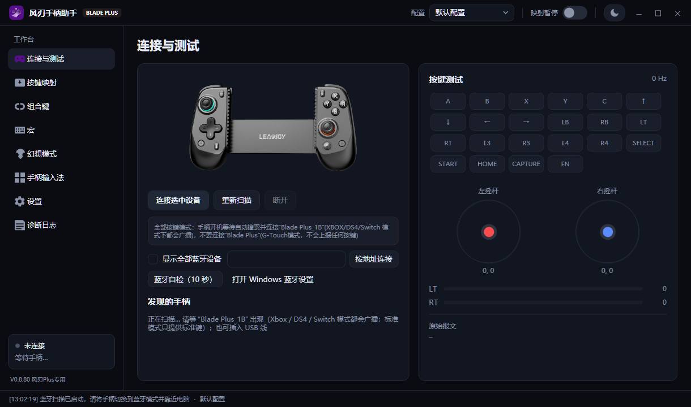
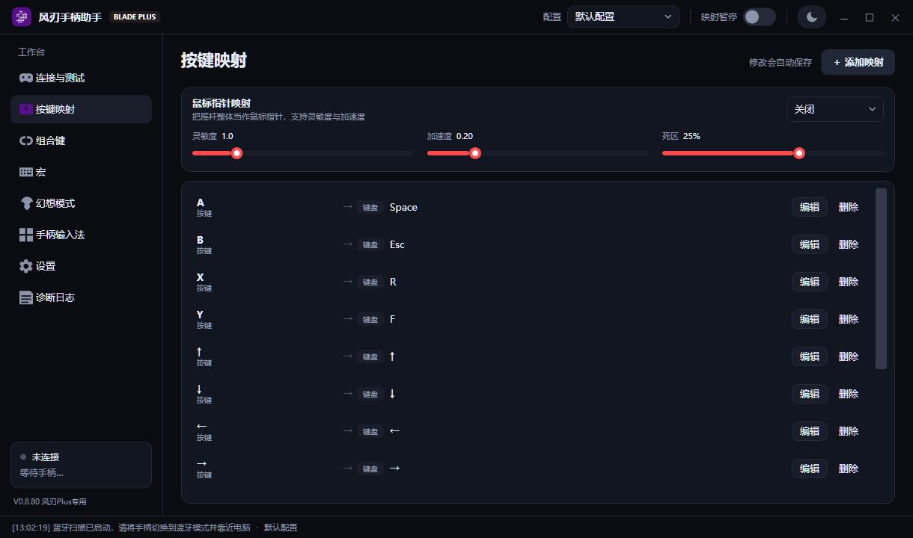
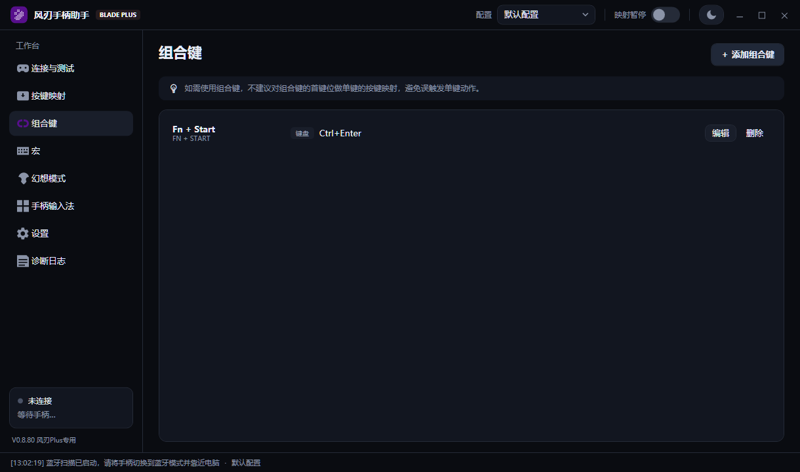
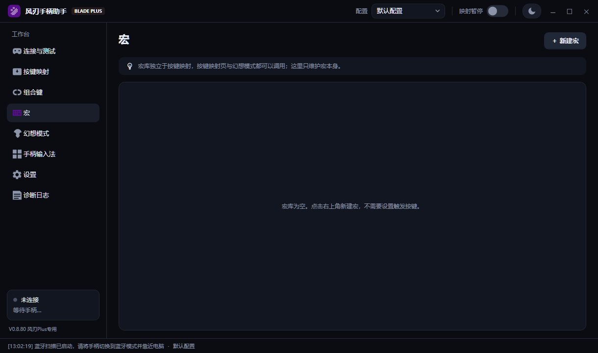
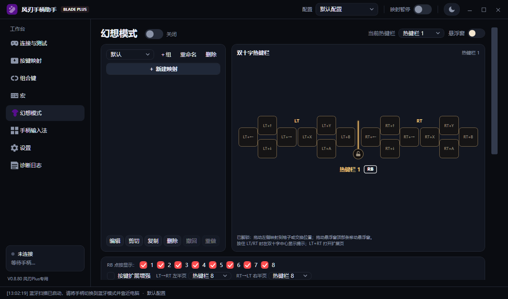
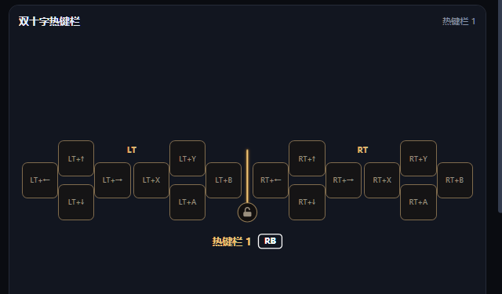
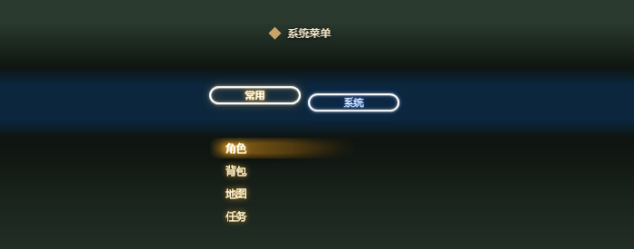
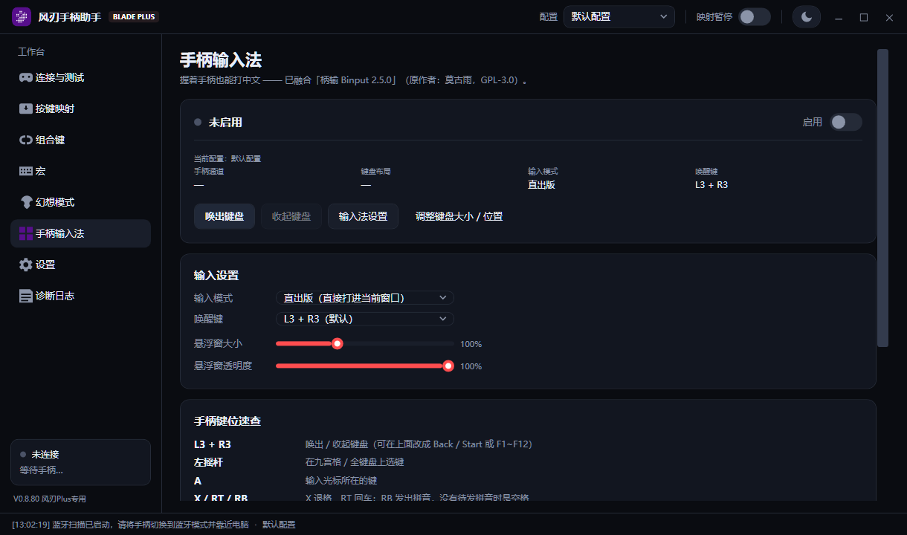
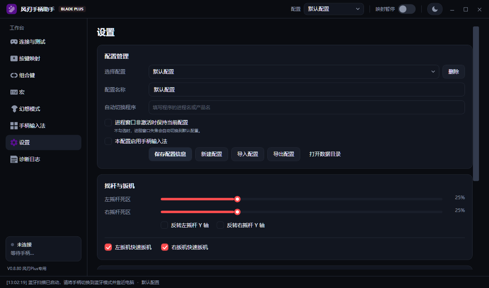

# 风刃手柄助手 · 使用说明

> **V0.8.81** ｜ Windows 10 2004+ / 11（x64） ｜ 作者：Yure5（幻色）
> 许可：GPL-3.0 ｜ B 站：[幻色](https://space.bilibili.com/549549) ｜ [项目主页](../README.md)

---

## 目录

1. [软件简介](#1-软件简介)
2. [安装与启动](#2-安装与启动)
3. [连接手柄](#3-连接手柄)
4. [界面总览](#4-界面总览)
5. [连接与测试](#5-连接与测试)
6. [按键映射](#6-按键映射)
7. [组合键](#7-组合键)
8. [宏](#8-宏)
9. [幻想模式](#9-幻想模式)
10. [系统菜单](#10-系统菜单)
11. [手柄输入法](#11-手柄输入法)
12. [设置](#12-设置)
13. [数据、备份与迁移](#13-数据备份与迁移)
14. [托盘与快捷操作](#14-托盘与快捷操作)
15. [常见问题](#15-常见问题)
16. [已知限制](#16-已知限制)
17. [版本与致谢](#17-版本与致谢)

---

## 1. 软件简介

风刃手柄助手把 **动感指尖 / Leadjoy 风刃 Plus** 手柄变成键盘、鼠标和宏键盘，并额外提供两套进阶玩法：**幻想模式**（双十字热键栏 + 系统菜单）和**手柄输入法**（用手柄打中文）。

它通过手柄的厂商蓝牙通道读取完整按键，包括普通 Xbox 模式看不到的扩展键。

### 1.1 支持的按键

| 分类 | 按键 |
| --- | --- |
| 面键 | A、B、X、Y、C、Z |
| 十字键 | ↑、↓、←、→ |
| 肩键 / 扳机 | LB、RB、LT、RT |
| 摇杆按下 | L3、R3 |
| 功能键 | SELECT、START、HOME、CAPTURE、Fn |
| 背键 | L4、R4（协议中的 M1、M2） |
| 摇杆方向 | 左摇杆 / 右摇杆各 4 个方向（共 8 个可映射方向） |

### 1.2 能实现什么

| 需求 | 做法 |
| --- | --- |
| 把手柄当键盘玩键鼠游戏 | 按键映射 / 组合键 / 摇杆当鼠标 |
| 一键连招、重复操作 | 宏 + 连发 / 切换 |
| 像 MMO 一样用手柄放技能 | 幻想模式双十字热键栏 |
| 在游戏里快速开菜单 | 系统菜单 |
| 躺着手柄聊天、打中文 | 手柄输入法 |

### 1.3 几个重要概念

- **映射**：手柄按键 → 键盘 / 鼠标 / 文本 / 宏。基础映射在「按键映射」页配置。
- **配置（Profile）**：一整套映射、组合键、宏引用、幻想模式和输入法开关。可以按游戏分别建配置，切到对应程序时自动切换。
- **幻想模式**：启用后接管手柄，使用双十字热键栏与系统菜单；此时「按键映射」和「组合键」页会置灰（两者互斥）。
- **手柄输入法**：独立开关，键盘唤出时暂停风刃映射，收起后恢复。

---

## 2. 安装与启动

### 2.1 下载

从 [Releases](../../releases/latest) 下载，二选一：

| 包 | 内容 | 适合 |
| --- | --- | --- |
| `LeadjoyBlade-V0.8.81-win-x64-clean.zip` | 初始空配置：无按键映射、无组合键、无宏 / 幻想库预设 | 新用户、想从零开始 |
| `LeadjoyBlade-V0.8.81-win-x64-sample.zip` | 示例配置（以《冒险岛》NewMaple 神射手为参考，供配置参考） | 想看配置写法、做参考 |

解压到任意**可写**目录。建议目录：

```
D:\Games\风刃手柄助手\
├─ LeadjoyBlade.exe
├─ 使用说明.pdf
├─ 手柄输入法说明.md
├─ 系统菜单说明.md
└─ （首次运行后自动生成 settings.json、profiles\ 等）
```

### 2.2 启动

双击 `LeadjoyBlade.exe`。

- 若 Windows 提示「已保护你的电脑」：点 **更多信息 → 仍要运行**。这是未签名程序的常见提示，不是病毒。
- 程序是 **self-contained 单文件**，**不需要安装 .NET**。
- 首次启动只创建一个名为「默认配置」的配置，且**映射默认暂停**（标题栏开关为关闭）。连好手柄后打开开关即可。

### 2.3 权限

- 平时用普通权限运行即可。
- 如果目标游戏以**管理员身份**运行，本程序也必须以管理员身份运行，否则注入的按键会被 Windows 的 UIPI 机制静默丢弃（表现为「程序里有反应，游戏里没反应」）。

### 2.4 便携与数据位置

所有数据默认写在 **exe 同目录**：

```
LeadjoyBlade.exe
settings.json            应用设置
profiles\*.json          每个配置一个文件
fantasy-library.json     幻想模式映射库
macro-library.json       全局宏库
save\Binput.save         手柄输入法存档（DPAPI 加密）
save\log.txt             输入法日志
logs\ble.log             蓝牙连接日志
logs\hiddle.log          HID 直读日志
startup.log              启动跟踪
crash.log                崩溃日志（仅异常时）
```

如果程序目录不可写（例如放在 `C:\Program Files` 下），会自动改用 `%AppData%\LeadjoyBlade`。想彻底重置：退出程序后删除上述文件和文件夹。

---

## 3. 连接手柄

### 3.1 先选对模式

风刃需要工作在 **XBOX / DS4 / Switch** 三种模式之一，先按普通手柄的方式与 Windows 配对（或插 USB）。连接成功后，程序会通过厂商通道识别到 **`Blade Plus_1B`**，这是完整按键通道。

| 模式 | 与 Windows 的连接 | 程序内通道 | 说明 |
| --- | --- | --- | --- |
| XBOX / DS4 / Switch | 正常蓝牙配对或 USB | `Blade Plus_1B` | 完整按键，推荐 |
| G-Touch | 仅屏幕映射 | — | 不上报按键 |

> **`Blade Plus_1B` 是程序内部识别到的厂商通道名，不会出现在 Windows 蓝牙配对列表里。** 在 Windows 里正常连接手柄即可。

> **蓝牙兼容性提示**：蓝牙 5.2 及更早版本可能与手柄厂商通道存在兼容性问题。如果 `Blade Plus_1B` 没有自动连接成功，可以尝试重启手柄；推荐使用瑞昱蓝牙 5.4 适配器或 USB 连接，适配更稳定、更快速。

### 3.2 配对步骤

1. **先打开程序**，停在「连接与测试」页；
2. 手柄开机，切到 XBOX / DS4 / Switch 模式；
3. 通过蓝牙或 USB 连接：
   - **蓝牙**：Windows **设置 → 蓝牙和其他设备 → 添加设备**，选择手柄（列表中不会显示 `Blade Plus_1B`）；
   - **USB**：直接用数据线连接；
4. 连接成功后，程序会识别到 `Blade Plus_1B` 并**自动连接**；未自动连接时点 **重新扫描**，选中设备后点 **连接选中设备**。

### 3.3 程序里的连接方式

| 方式 | 操作 | 适用场景 |
| --- | --- | --- |
| 自动连接 | 打开程序后等待 | 已连接过的 XBOX/DS4/Switch 手柄 |
| 手动连接 | 选中设备 → **连接选中设备** | 自动连接失败 |
| 双击连接 | 双击候选列表中的设备 | 快速连接 |
| 按地址连接 | 输入 12 位十六进制蓝牙地址 | 设备名异常 / 没有广播 |
| USB 有线 | 直接插数据线 | 蓝牙干扰大、需要稳定 |

- **重新扫描**：清空候选并重新枚举已配对设备。
- **显示全部蓝牙设备**：连不上的时候勾选，可看到附近所有 BLE 广播。
- **蓝牙自检（10 秒）**：强制扫描 10 秒并统计收到的广播数。结果为 0 说明手柄没有在 BLE 广播（通常被手机 App 占用，或 Windows 仍以 Xbox/PS 方式连着它）。
- **打开 Windows 蓝牙设置**：跳到系统蓝牙页面。
- 已连接后按钮会变成 **切换设备**，旁边是 **断开**。

### 3.4 连不上时按顺序排查

1. 确认手柄处于 `XBOX / DS4 / Switch` 模式，并已在 Windows 里连接；
2. 关掉手机上的官方 App（BLE 同一时间只能被一个主机占用）；
3. Windows 蓝牙设置里删除旧的手柄记录，重新配对；
4. 换 USB 线直连；
5. 更新主板 / 蓝牙适配器驱动（部分 Realtek 旧驱动不稳定）；
6. 打开 **诊断日志**，看 `logs\ble.log` 的记录。

---

### 3.5 用 Steam 启动游戏时（推荐设置）

Steam 自带手柄支持，可能和本程序抢手柄、重复注入，导致映射错乱或按键无反应。建议**给 Steam 快捷方式禁用 Steam 的手柄支持**：

1. 找到 Steam 的桌面快捷方式，右键 → **属性**；
2. 在 **目标** 输入框的末尾加一个空格，再追加 `-nojoy`：

   ```
   "C:\Program Files (x86)\Steam\steam.exe" -nojoy
   ```

3. 点 **确定** 保存；
4. 先退出已经运行的 Steam，再**用这个快捷方式重新启动 Steam**，然后正常进游戏。

> ⚠️ 参数只对通过该快捷方式启动的 Steam 生效。如果 Steam 是开机自启的，先在托盘退出，再用改过的快捷方式启动。
>
> 💡 也可以同时在 Steam 里关闭「Steam 输入」：设置 → 控制器 → Steam 输入 → 禁用。两种做法不冲突。

---

## 4. 界面总览



### 4.1 左侧工作台

| 页面 | 作用 |
| --- | --- |
| 连接与测试 | 搜索、连接设备，查看按键 / 摇杆 / 扳机 / 报文 |
| 按键映射 | 单键 → 键盘 / 文本 / 鼠标 / 宏 |
| 组合键 | 多键同时按下 → 一个动作 |
| 宏 | 编辑全局宏库 |
| 幻想模式 | 双十字热键栏、基础键位、悬浮窗、系统菜单 |
| 手柄输入法 | 手柄打字 |
| 设置 | 配置管理、摇杆、启动、托盘 |
| 诊断日志 | 查看连接与运行日志 |

窗口宽度小于 1000 px 时，左侧栏会收起，导航移到顶部横向排列。

### 4.2 标题栏

- **配置**：下拉切换当前配置，切换立即生效；
- **映射开启 / 映射暂停**：总开关。关闭会立即释放所有按下的键；
- **主题按钮**（月亮 / 太阳）：浅色 / 深色主题，自动保存；
- 最小化、最大化、关闭（关闭 = 最小化到托盘，不退出）。

### 4.3 状态栏

底部显示最近一条状态信息与当前配置名；左下角状态卡显示连接状态、设备名和版本号。

---

## 5. 连接与测试


### 5.1 左侧：设备

- 手柄大图；未连接时显示「未连接」；
- 连接 / 重新扫描 / 断开；
- 提示条与全部设备开关、蓝牙地址输入、蓝牙自检；
- **发现的手柄** 列表：双击任意候选即可连接。

### 5.2 右侧：按键测试

| 区域 | 内容 |
| --- | --- |
| 按键芯片 | 22 个标准键，按下时高亮 |
| 左 / 右摇杆 | 圆点实时跟随；圆内灰色实心圈是**当前配置的死区范围** |
| LT / RT | 进度条 + 原始数值 |
| 原始报文 | 按键位图与原始字节，排查协议问题用 |
| 频率 | 右上角显示上报频率（Hz） |

- 按键测试约 30 fps 刷新，帧率每秒统计一次。
- Switch / BLE 低上报时频率会明显偏低（10–40 Hz），属正常现象。
- **震动测试** 芯片只在 Xbox XInput 链路下出现，点按会震动 0.5 秒。

> 💡 摇杆数值是原始整型值（约 -32768 \~ 32767），不是百分比。

---

## 6. 按键映射



### 6.1 鼠标指针映射（页面顶部卡片）

把整个摇杆当成鼠标指针：

| 参数 | 范围 | 默认 | 说明 |
| --- | --- | --- | --- |
| 摇杆 | 关闭 / 左摇杆 / 右摇杆 | 关闭 | 二者只能选一个 |
| 灵敏度 | 0.1 – 5.0 | 1.0 | 整体移动速度 |
| 加速度 | 0 – 1.0 | 0.2 | 推杆越满，加速越明显 |
| 死区 | 0 – 40% | 25% | 中心不触发移动的范围 |

修改后自动保存。

### 6.2 添加 / 编辑映射

1. 点右上角 **＋ 添加映射**；
2. **手柄按键**：下拉选择，或点 **捕获按键** 后按手柄；

   - 捕获摇杆方向时，推过死区才会选中；
   - 斜向不会生成独立来源，会取占优方向；运行时会自动同时按下水平和垂直两个方向键；
3. **动作类型**：

| 动作类型 | 可设置 |
| --- | --- |
| 键盘按键 | 捕获按键 + Ctrl / Alt / Shift / Win 修饰键 |
| 输入文本 | 一段文字（支持中文） |
| 鼠标按键 | 左键 / 右键 / 中键 / 侧键 1 / 侧键 2 |
| 鼠标滚轮 | 向上 / 向下 |
| 宏 | 从全局宏库选择一个宏 |
| 不映射 | 屏蔽该按键 |

4. 可勾选：

   - **按住连发**：按住期间循环触发，间隔 15–2000 ms（默认 50 ms）；
   - **按一下切换（开 / 关）**：按一下保持按下，再按一下松开；
5. **保存** 后立即生效；所有修改自动写入 `profiles\<配置名>.json`。

> 💡 **连发**只对键盘 / 鼠标按键 / 滚轮动作生效；文本、宏不连发。
> 💡 **切换**不会在松开手柄时释放，需要用同一个键再按一次关闭，或用总开关暂停映射。

### 6.3 固定鼠标位置

动作类型为 **鼠标按键** 或 **鼠标滚轮** 时，会出现 **设置鼠标位置**：

1. 点击后屏幕变暗，出现圆形准星和实时坐标；
2. **左键** 落点；**按住准星拖动** 微调；**ESC** 保存退出；
3. 按钮右侧会显示记录的位置，例如「鼠标位置：窗口 43.2% / 61.5%」。

坐标规则：

- **配置里填了进程名** → 相对该进程**客户区**的百分比；窗口移动、改分辨率后仍点在同一相对位置；
- **没填进程名** → 相对**点击所在的显示器**记录；多屏不会点错屏。

未设置位置时，鼠标动作使用当前光标位置。

## 7. 组合键



### 7.1 新建组合键

1. 进入 **组合键**，点 **＋ 添加组合键**；
2. 填写 **名称**；
3. 勾选 **2 个以上** 手柄按键，或点 **从手柄捕获** 后同时按住组合键 **3 秒**；
4. 选择触发的动作（与按键映射的动作类型相同）；
5. 保存。

### 7.2 规则

- 组合键优先于单键映射：组合内任意一个源都不会再触发自己的单键动作；
- 最长组合优先（3 键 > 2 键）；
- **45 ms 防误触**：按下组合中的键后，单键动作会等 45 ms；期间组合凑齐则取消单键；
- 任一键松开即结束组合。

> ⚠️ 不建议给组合键的首键再单独配一个单键动作，否则容易出现「想按组合却先触发单键」。

### 7.3 典型例子

| 组合 | 动作 |
| --- | --- |
| `Fn + L4` | `F1` |
| `LB + RB` | `Esc` |
| `Fn + START` | `Ctrl + Enter`（默认配置已内置） |

---

## 8. 宏



### 8.1 宏库

- 宏是**独立的动作序列**，不绑定触发键；按键映射、幻想模式、系统菜单都可以调用它。
- 列表显示名称、步骤数；支持编辑、删除。
- 增删改立即写入 `macro-library.json`。

### 8.2 编辑宏

点 **＋ 新建宏** 或 **编辑** 打开编辑窗口。

**手动添加步骤：**

1. 选择 **设备**：手柄 / 键盘 / 鼠标；
2. 选择具体按键；
3. 选择 **动作**：单击 / 按下 / 弹起（鼠标额外支持双击）；
4. 点 **添加步骤**，新步骤会插到当前选中步骤的**下方**。

**其他步骤类型：**

- **添加延迟**：插入「等待 100 ms」，可直接改数值；
- **添加文本**：输入一段文字（支持中文），执行时送到当前窗口；
- **捕获按键**：直接按键盘 / 鼠标 / 手柄，自动识别设备与按键。

**录制：**

1. 点 **● 开始录制**；
2. 直接敲键盘或按手柄，程序会记录按键和间隔，并自动插入延迟步骤；
3. 按 **Esc** 停止。

**编辑技巧：**

| 操作 | 方式 |
| --- | --- |
| 调整顺序 | 拖动行首 **☰**（点其他位置不会拖动） |
| 多选 | Ctrl / Shift 点击 |
| 复制 / 剪切 / 粘贴 | Ctrl+C / Ctrl+X / Ctrl+V（粘贴到选中步骤之后） |
| 删除 | Delete |
| 改按键 | 点击步骤里的按键方块后按新键 |
| 改文字 | 双击文本步骤 |
| 改按住 / 间隔 | 直接点输入框修改，范围 0–60000 ms |

### 8.3 固定鼠标位置

设备选 **鼠标** 时，工具栏会出现 **设置鼠标位置**，与按键映射、系统菜单使用同一套采集流程（窗口百分比 / 显示器百分比）。设置后该鼠标步骤会在固定位置点击；未设置时点击当前光标。

### 8.4 执行语义

- 宏按顺序执行，步骤之间有延迟；
- **手柄步骤**会把该手柄键按当前配置的基础层映射翻译成键盘 / 鼠标动作执行（程序没有虚拟手柄驱动，不会向系统输出手柄报文）；
- 宏执行期间暂停映射或断联，会立即中断并释放按键。

---

## 9. 幻想模式



幻想模式把手柄变成一套「双十字热键栏 + 系统菜单」的 MMO 手柄方案。

### 9.1 启用

1. 进入 **幻想模式**，打开右上角开关；
2. 打开 **悬浮窗** 开关（也可用 `LT + SELECT` 随时显示 / 隐藏）；
3. 启用后「按键映射」和「组合键」页会置灰——幻想模式接管手柄，两者互斥。

### 9.2 双十字热键栏



- **8 套热键栏**，每套 **16 格**：LT 半区 8 格 + RT 半区 8 格；
- 格子顺序固定：

```
LT 半区：LT+↑  LT+↓  LT+←  LT+→  LT+Y  LT+X  LT+B  LT+A
RT 半区：RT+↑  RT+↓  RT+←  RT+→  RT+Y  RT+X  RT+B  RT+A
```

- 按住 **LT** 或 **RT**，再按对应方向键 / 面键，即可触发格子里的映射；
- 两边同时按住（LT+RT）且启用了「按键扩展增强」时，会进入**扩展页**，只显示对应半区的 8 格。

**RB 的两种用法：**

| 操作 | 效果 |
| --- | --- |
| 点按 RB（≤180 ms） | 切到下一个「可见」热键栏 |
| 长按 RB（>180 ms） | 打开热键栏选择条，按 Y=1、B=2、A=3、X=4、↑=5、→=6、↓=7、←=8 直选 |

页面上的「RB 点按显示：1–8」复选框决定点按循环时跳过哪些栏。

### 9.3 编辑热键栏

右侧预览区可**直接编辑**：

- **解锁状态**：从左侧映射列表把条目拖到格子上；拖到已有格子上可交换位置；拖动悬浮窗顶部条可移动悬浮窗；
- **锁定状态**：格子不可编辑；鼠标点击格子等同于按一次对应的手柄组合键（可用于测试）；
- 点中间的分隔线锁图标切换锁定 / 解锁；
- 支持多选、框选、拖动排序、右键菜单、Ctrl+A / C / X / V / Z / Y、Delete。

左侧映射库：

- 「＋组 / 重命名 / 删除」管理标签组；
- 「＋ 新建映射」创建映射项（名称、图标、动作）；
- 编辑 / 剪切 / 复制 / 删除 / 撤回 / 重做（撤回最多 30 步）。

### 9.4 基础键位（17 键）

不按 LT/RT 时，基础键位生效：

| 键位 | 默认说明 | 默认动作 |
| --- | --- | --- |
| A | 确认 | Enter |
| B | 取消 | Esc |
| X | 对话 | Y |
| Y | 跳跃 | Alt |
| ↑ ↓ ← → | 方向 | 方向键 |
| LB | 拾取 | Z |
| L4 | 左键 | 鼠标左键 |
| R4 | 右键 | 鼠标右键 |
| SELECT | 商城 | ``` |
| START | 坐骑 | `-` |
| CAPTURE | 截图 | Tab |
| C | 自定义 | 不映射 |
| L3 | 下压 | 不映射 |
| Fn | 功能 | 不映射 |

点击任意基础键卡片可打开编辑器，改为键盘 / 手柄 / 鼠标 / 文本 / 宏动作。

> 💡 被占用的基础键会**置灰不可点**：灵敏度切换键、系统菜单呼出键、手柄输入法唤醒键。

### 9.5 指针、灵敏度与扩展

| 设置 | 说明 |
| --- | --- |
| 灵敏度档位 | 逗号分隔，默认 `0.5, 1, 1.5, 2.2`；`RB + R3` 循环切换 |
| 切换键 | `CAPTURE`（默认）或 `C`；选中的键会从基础键位里置灰 |
| 左摇杆 | 方向键（默认）或 WASD |
| 按键扩展增强 | 启用后 LT+RT 打开扩展页 |
| LT→RT 左半页 / RT→LT 右半页 | 扩展页使用哪一套热键栏（默认第 8 套） |
| 缩放 / 透明度 | 悬浮窗大小 10%–150%，透明度 0%–100% |
| 鼠标穿透 | 默认开启；解锁悬浮窗时会自动关闭，便于拖动 |
| 热键栏切换音效 | 勾选启用；音量 0%–100%，默认 100% |

### 9.6 固定组合（不受映射影响）

| 组合 | 动作 |
| --- | --- |
| `LT + R3` | 按住鼠标左键 |
| `RT + R3` | 按住鼠标右键 |
| `RB + R3` | 切换灵敏度档位 |
| 单按 `R3` | 开 / 关滚轮模式 |
| `LT + SELECT` | 显示 / 隐藏悬浮窗 |
| `LT + RT` | 打开扩展页（需启用扩展） |

### 9.7 悬浮窗

- 顶部拖动条「⠿ 拖动悬浮窗」可移动；位置、缩放、透明度都保存到当前配置；
- 支持拖到任意显示器（按虚拟桌面边界夹取）；
- 锁定后拖动条隐藏，避免误拖。

---

## 10. 系统菜单

系统菜单是一条贯穿屏幕顶部的横向指令带：上方是菜单栏，下方是当前菜单栏的项目列表。



### 10.1 启用

在 **幻想模式** 页的「系统菜单」卡片：

1. 勾选 **启用系统菜单**；
2. 选择 **呼出键**：`SELECT`（默认）或 `START`；
3. 选择 **确认键**：`A`（默认）/ B / X / Y；
4. 选择 **取消键**：`B`（默认）/ A / X / Y（不能与确认键相同）；
5. 点 **编辑菜单与项目…** 配置内容；
6. **菜单呼出音效**：勾选启用，可调音量 0%–100%。

### 10.2 菜单打开时

| 输入 | 行为 |
| --- | --- |
| 呼出键 | 打开 / 收起菜单 |
| ← → | 切换菜单栏（到边界停住，不回绕） |
| ↑ ↓ | 选择项目（到边界停住） |
| 确认键 | 执行项目并关闭菜单 |
| 取消键 | 关闭菜单，不执行 |
| 其他按键 | 保持幻想模式原映射 |
| ABXY 同时按 2 个及以上 | 视为手柄组合键，不触发确认 / 取消 |
| 按住 LT / RT | 菜单保持显示，但不接收方向 / 确认 / 取消 |

- 长按方向键约 340 ms 后开始连续移动，间隔 90 ms；由本地定时器驱动，BLE 低上报也能连续翻页。
- 鼠标点击菜单外区域会关闭菜单。

### 10.3 编辑菜单与项目

编辑器左侧是**菜单栏**（顶部横向分类），右侧是当前菜单栏的**项目**（纵向列表）。

**菜单栏操作：**

- ＋ 新建菜单、重命名（F2）、删除、↑ / ↓ 排序；
- 右键：编辑 / 剪切 / 复制 / 粘贴 / 删除；快捷键 Ctrl+C / X / V、Delete。

**项目操作：**

- ＋ 新建项目；双击或 Enter 编辑；Delete 删除；
- 支持多选、剪切 / 复制 / 粘贴、↑ / ↓ 排序；
- 空白处右键只有「粘贴」，粘到末尾；项目上右键插入到其后；
- 剪切项会半透明显示「已剪切」，粘贴时是移动而不是复制。

### 10.4 五种项目动作

| 动作 | 说明 |
| --- | --- |
| **键盘按键** | 捕获主键 + Ctrl / Alt / Shift / Win 修饰键 |
| **手柄按键** | 可多选组合；按当前幻想基础键位翻译成游戏收到的键鼠动作（不是虚拟手柄） |
| **鼠标点击** | 记录相对位置（窗口客户区 % 或显示器 %）+ 鼠标按键 |
| **文本输入** | 一段文字；中文由系统输入法处理，建议在中文输入状态下使用 |
| **独立宏** | 仅属于当前项目：键盘 / 手柄 / 鼠标点击 / 文本 / 延迟步骤混排 |

**设置鼠标位置：**

- 配置了进程 → 在游戏窗口上覆盖遮罩，按客户区百分比记录；
- 未配置进程 → 按点击所在的显示器记录，多屏不点错；
- 左键落点、拖动准星微调、ESC 保存退出。

### 10.5 默认菜单

首次启用自带两个菜单栏：

- **常用**：角色 C / 背包 I / 地图 M / 任务 J；
- **系统**：系统菜单 Esc / 截图 PrintScreen。

可随时修改或删除。

> ⚠️ 系统菜单动作**不做进程判断**：只要菜单打开，按键就会发到当前前台窗口，不会自动切换窗口。请在目标窗口已在前台时使用。

---

## 11. 手柄输入法



手柄输入法融合自开源项目 **柄输 Binput 2.5.0**（作者：莫古雨，GPL-3.0），源码已编入本程序，**不需要另外安装或启动 Binput**。

### 11.1 启用与停用

1. 进入 **手柄输入法**，打开右上角 **启用**；
2. 按手柄 **L3 + R3** 唤出 / 收起悬浮键盘；
3. 停用：关闭同一个开关，或在输入法设置里点「停用」。

也可以从托盘右键 →「手柄输入法」子菜单操作：显示 / 隐藏键盘、输入法设置、启用 / 停用。

> 💡 **启用只表示「热键可以唤醒」**。键盘收起时不会查询或修改系统输入法，`Ctrl+Space` 等正常中英切换不受影响。

### 11.2 两种输入模式

| 模式 | 界面 | 文字去向 | 适合 |
| --- | --- | --- | --- |
| **预输入版**（推荐） | 带预览框 | 先打进预览框，收起时整段复制 + 粘贴 | 游戏聊天、FF14 等，不会吃到半截按键 |
| **直出版** | 无预览框、不抢焦点 | 按键直接送到当前窗口 | 普通 Windows 窗口 |

- 中英文切换：按手柄 **Y** 在「九键（中文拼音）」和「全键盘（英文）」之间切换；
- 直出版打中文前，目标窗口需要先处于中文输入法；游戏里建议用预输入版。

### 11.3 手柄键位

| 按键 | 作用 |
| --- | --- |
| `L3 + R3` | 唤出 / 收起（可改成 Back / Start / Back+Start / L3 / R3 或 F1–F12） |
| 左摇杆 | 九宫格 / 全键盘选键 |
| A | 输入光标所在的键（按住连发） |
| X | 退格 |
| RT | 回车 |
| RB | 发出拼音；没有待发拼音时是空格 |
| 十字键 ← → | 拼音切分；发出拼音后是方向键 |
| 十字键 ↑ ↓ | 候选翻页 |
| Y | 有拼音时只定住头一个字；没拼音时单击切九键 / 全键盘，长按约 0.5 秒进设置 |
| LT（按住） | 数字层 |
| LB（按住） | 九键：滑行输入；全键盘：Shift 大写（保持到松开） |
| 右摇杆 | 九键上翻出标点层，停约 0.18 秒输入该标点；不回中直接换格会替换上一个标点；回中即确认 |

### 11.4 输入设置

| 设置 | 范围 / 选项 |
| --- | --- |
| 输入模式 | 预输入版（推荐）/ 直出版 |
| 唤醒键 | L3+R3（默认）/ Back / Start / Back+Start / L3 / R3 / F1–F12 |
| 悬浮窗大小 | 60% – 180% |
| 悬浮窗透明度 | 20% – 100% |

- 滑块实时生效，停手约 0.35 秒后自动保存；
- **调整键盘大小 / 位置**：用十字键上下缩放、左摇杆挪位置，按 B 结束；
- **输入法设置** 或悬浮键盘右下角齿轮：打开完整设置页（主题、皮肤、键盘布局、双拼、滑行、快捷短语、维护等）。

### 11.5 悬浮窗

- 左下角小锁默认**锁住**；点一下开锁，锁梁水平镜像翻转，顶部出现胶囊拖动条；
- 按住拖动条可移动，多屏可直接拖到任意显示器；
- 位置、大小、透明度、锁定状态都会记住，重启后恢复；
- 再点小锁可锁回去，拖动条隐藏。

### 11.6 按配置保存与冲突

- 输入法的**开关 / 输入模式 / 唤醒键**保存在当前配置里；「设置 → 配置管理」也有「本配置启用手柄输入法」；
- 切换配置时自动启动 / 停止并按该配置应用；
- 唤醒键与映射、组合键、幻想基础键、系统菜单呼出键冲突时，页面会显示黄色提示（只提示，不阻止）；
- 与幻想基础键同键时（例如 L3），该基础键会**置灰**，运行时也不再映射。

### 11.7 手柄通道

- 风刃已连接时，输入法**直接使用风刃解析好的手柄状态**，BLE 1B / Switch / DS4 / XInput 都可用；
- 没有连接风刃时，自动回退到 Binput 原生的 XInput / Windows.Gaming.Input / HID 三条通道；
- 输入法键盘**唤出期间**，风刃映射与幻想模式暂停；收起后自动恢复；
- 死区跟随「设置 → 摇杆与扳机」里的左右摇杆死区。

### 11.8 注意

- 游戏以管理员身份运行时，本程序也要以管理员身份运行；
- 输入法会模拟键盘输入，可能被部分反作弊游戏拦截，**风险请自行判断**；
- 输入法界面是置顶悬浮窗，独占全屏游戏可能盖住它，建议使用无边框窗口化。

---

## 12. 设置



### 12.1 配置管理

| 操作 | 说明 |
| --- | --- |
| 选择配置 | 下拉切换，立即生效 |
| 配置名称 | 重命名后点「保存配置信息」 |
| 自动切换程序 | 填进程名或产品名，例如游戏 exe |
| 进程窗口非激活时保持当前配置 | 不勾选时，失焦后自动切回默认配置 |
| 本配置启用手柄输入法 | 随配置保存 |
| 保存配置信息 | 保存名称、进程名、映射开关状态 |
| 新建配置 | 复制当前配置的按键、组合键、宏、摇杆参数与输入法段 |
| 导入 / 导出配置 | 单个或多个配置的 JSON 导入导出 |
| 删除 | 删除当前选中的配置 |
| 打开数据目录 | 在资源管理器中打开 |

**进程匹配规则**：进程名、`进程名.exe`、文件说明 / 产品名 / 文件名都可匹配；内置 Edge / Chrome / Firefox / 记事本 的别名。程序自身窗口不参与自动切换。

**导入导出格式**：

```json
{
  "version": 1,
  "profiles": [ { "name": "...", "bindings": [], "chords": [], "fantasy": {}, "settings": {}, "ime": {} } ]
}
```

重名导入会自动改名为 `原名 (导入)`、`原名 (导入) 2`。

> ⚠️ 首次运行只创建「默认配置」；旧版本的其他配置不会自动复制，请用「导入配置」迁移。

### 12.2 摇杆与扳机

| 设置 | 范围 | 默认 |
| --- | --- | --- |
| 左摇杆死区 | 5% – 80% | 25% |
| 右摇杆死区 | 5% – 80% | 25% |
| 反转左 / 右摇杆 Y 轴 | 开 / 关 | 关 |
| 左 / 右扳机快速扳机 | 开 / 关 | 开 |

- 死区会显示在按键测试的摇杆圆内，也会同步给手柄输入法；
- **快速扳机**：扳机模拟量超过 0.5 即视为对应 L2 / R2 按下。

### 12.3 启动与托盘

| 设置 | 默认 | 说明 |
| --- | --- | --- |
| 启动时默认开启映射 | 关 | 勾选后下次启动自动开启映射 |
| 开机自动启动 | 关 | 写入注册表 Run 项，启动时隐藏到托盘 |
| 关闭窗口时最小化到托盘 | 开 | 关闭窗口不退出，映射继续后台运行 |
| 根据前台程序自动切换配置 | 开 | 见 12.1 |

### 12.4 主题

标题栏右侧的太阳 / 月亮按钮切换浅色 / 深色，自动保存（全局设置，不随配置变化）。

---

## 13. 数据、备份与迁移

### 13.1 文件清单

| 文件 / 目录 | 内容 | 是否适合分享 |
| --- | --- | --- |
| `profiles\*.json` | 按键映射、组合键、幻想模式、摇杆参数、输入法开关 | ✅ 可分享 |
| `fantasy-library.json` | 幻想模式映射库 | ✅ 可分享 |
| `macro-library.json` | 全局宏库 | ✅ 可分享 |
| `settings.json` | 主题、启动、托盘等应用设置 | ⚠️ 含本机偏好 |
| `save\Binput.save` | 输入法存档（DPAPI 加密，换机无法解密） | ❌ 不建议 |
| `logs\*` | 诊断日志 | ⚠️ 可能含设备名 |

### 13.2 备份

退出程序后，复制 `profiles\`、`fantasy-library.json`、`macro-library.json` 即可。配置是普通 JSON，可直接用文本编辑器查看和修改（建议先备份）。

### 13.3 迁移到新电脑

1. 复制整个程序目录（至少 exe + 上述配置文件）；
2. 输入法存档是 DPAPI 加密的，**不能跨电脑复制**，需要在新电脑重新设置；
3. 首次启动后重新连接手柄（XBOX / DS4 / Switch 模式）。

### 13.4 重置

退出程序 → 删除 `settings.json` 和 `profiles\` → 重新启动。程序会重新创建默认配置（映射默认暂停）。

---

## 14. 托盘与快捷操作

### 14.1 托盘菜单

右键托盘图标：

- **打开主界面**
- **启用 / 暂停映射**
- **手柄输入法** → 显示 / 隐藏键盘、输入法设置…、启用 / 停用
- **退出**

双击托盘图标 = 打开主界面。

### 14.2 快捷操作汇总

| 操作 | 效果 |
| --- | --- |
| 再次双击 exe | 唤醒已运行的实例并显示主窗口 |
| 关闭窗口 | 最小化到托盘（不退出） |
| 标题栏开关 | 暂停 / 恢复全部映射，立即释放按住的键 |
| `LT + SELECT` | 显示 / 隐藏幻想模式悬浮窗 |
| `L3 + R3` | 唤出 / 收起手柄输入法键盘 |

> 说明：本程序**不注册系统级键盘热键**，全局操作请使用托盘菜单或手柄组合键。

---

## 15. 常见问题

### 15.1 连接类

**Q：找不到手柄，或连接后按键没反应？**

1. 确认手柄处于 **XBOX / DS4 / Switch** 模式，并已在 Windows 里连接（`Blade Plus_1B` 只在程序内显示）；
2. G-Touch 模式不会上报任何按键；
3. 关闭手机上的官方 App；
4. Windows 蓝牙设置里删除旧记录，重新配对；
5. 点「重新扫描」，或改用 USB 线。

**Q：蓝牙经常断开 / 搜不到？**

- 更新主板或蓝牙适配器驱动（部分 Realtek 旧驱动不稳定）；
- 尽量使用 瑞昱蓝牙5.4适配器或有线连接；
- 蓝牙自检结果为 0 时，说明手柄没有在广播，多半被手机占用。

**Q：手柄换模式后要手动「重新扫描」才出现？**

V0.8.55 起后台每 5 秒重新枚举，一般会自动出现；仍没有就点一次「重新扫描」，或检查手柄是否被其他程序独占。

**Q：多人/多手柄？**

同一时间只处理一个已连接设备。DS5、DS4、Switch、Xbox 手柄也可以连，但只有风刃 `_1B` 厂商通道能读扩展键。

### 15.2 映射类

**Q：游戏里按键无效？**

- 部分游戏用独占 Raw Input 或反作弊，会忽略 `SendInput`；
- 右键程序「以管理员身份运行」（游戏是管理员时必须）；
- 先在记事本里测试映射能否输出字符；
- 确认没有被 Steam Input、DS4Windows、Controller Companion 抢占。

**Q：摇杆方向相反？**

设置 → 摇杆与扳机 → 勾选「反转左/右摇杆 Y 轴」。

**Q：摇杆有虚位 / 推到底不到边缘？**

先调死区；物理推到底仍不到边缘通常是手柄传感器提前饱和，属硬件限制。

**Q：连发只触发一次？**

确认动作类型是键盘按键 / 鼠标按键 / 鼠标滚轮（宏和文本不连发），并且连发间隔不是特别大。BLE 低上报下按键保持不受影响。

**Q：Fn 层映射在哪里改？**

当前界面只编辑基础层；Fn 层条目保留在 `profiles\*.json`，可手动编辑 `"layer": "Fn"` 的绑定。

**Q：用 Steam 启动的游戏里映射错乱，或者手柄被 Steam 抢走？**

Steam 自带的手柄支持会和本程序冲突。建议给 Steam 快捷方式加 `-nojoy` 参数禁用：

1. 右键 Steam 快捷方式 → **属性**；
2. 在「目标」末尾加一个空格，追加 `-nojoy`；
3. 保存后，用这个快捷方式启动 Steam。

详细步骤见 3.5 节。

### 15.3 幻想模式 / 系统菜单

**Q：幻想模式开了以后按键映射页灰了？**

这是设计行为：幻想模式接管手柄，与按键映射 / 组合键互斥。关闭幻想模式即可恢复。

**Q：系统菜单确认 / 取消后 A/B 还会触发映射？**

V0.8.51 起已修复：菜单关闭那一帧如果确认 / 取消键还按着，会锁到松开为止。

**Q：系统菜单不切换前台窗口？**

当前设计不做进程判断、不自动激活窗口。请先把目标窗口切到前台再呼出菜单。

**Q：悬浮窗被游戏盖住？**

独占全屏游戏会盖住所有 Topmost 窗口；请使用无边框窗口化。

### 15.4 手柄输入法

**Q：开启输入法后 Ctrl+Space 切不了中文？**

V0.8.47 已修复：键盘收起时不再查询前台窗口的 IME。若仍遇到，确认版本 ≥ V0.8.47，并按 L3 收起键盘后再试。

**Q：唤不出 / 打不出字？**

- 确认页面「启用」已打开，且手柄通道不是「未检测到手柄」；
- 游戏管理员运行时，本程序也要管理员运行；
- 中英文按 **Y** 切换（九键 / 全键盘）；
- 直出版中文需要目标窗口先切到中文输入法；
- 详见 [手柄输入法说明](INPUT-METHOD.md)。

**Q：唤醒后自动翻到标点页 / 连续输出标点？**

V0.8.47 已修复第三方 DS4 轴序误判；可在 `logs\hiddle.log` 查看「轴布局：DS4/PlayStation」确认。

**Q：左摇杆选格上下颠倒 / 容易跳斜方向？**

V0.8.47 已修正 Y 反相与斜角阈值（两轴都 > 0.35 才算斜向）；仍异常请把 `hiddle.log` 的轴值发给开发者。

**Q：手柄关机后鼠标一直往左上跑？**

V0.8.48 已修复：断联会立即释放摇杆、按键和鼠标。

**Q：全键盘按住 LB 大写一下又变回小写？**

V0.8.52 已修复：直连通道宽限从 500 ms 提高到 10 秒。

**Q：输入法怎么按配置区分？**

V0.8.56 起开关、输入模式、唤醒键保存在当前配置；置灰只看顶部当前配置。

**Q：悬浮窗大小 / 透明度 / 锁定 / 拖动？**

见 [11.4–11.5](#114-输入设置)。

### 15.5 程序类

**Q：程序打不开？**

- 确认 exe 完整（约 80 MB），不要只复制了一部分；
- 发布版自带 .NET，不需要另装运行时；
- 查看同目录 `crash.log`。

**Q：提示缺少运行时？**

说明下载的不是完整发布版；请重新下载完整 zip。

**Q：怎么彻底退出？**

托盘右键 → 退出；直接关窗口只会最小化到托盘。

---

## 16. 已知限制

1. **独占全屏**游戏可能盖住悬浮窗（幻想模式、系统菜单、输入法），建议无边框窗口化。
2. **Raw Input 独占鼠标**的游戏可能忽略 `SendInput`；部分反作弊会拦截注入。
3. 游戏以管理员运行时，本程序也必须以管理员运行，否则按键被 UIPI 静默丢弃。
4. 标准 Xbox / DS4 / Switch HID 模式读不到 Fn、L4/R4、C/Z、Capture；只有程序内识别到的 `Blade Plus_1B` 厂商通道能读全。
5. 2.4G 接收器 / 有线 Xbox 模式通常只暴露标准 Xbox 协议。
6. Switch 模式扳机只有 0/255 数字量。
7. 程序没有虚拟手柄驱动；「手柄按键」动作是按基础键位翻译成键鼠，不会向系统输出手柄报文。
8. 系统菜单不做进程过滤、不自动切前台；确认后总是关闭菜单。
9. 系统菜单与悬浮窗在未配置进程时只落在主屏工作区。
10. 手柄输入法唤醒键为 L3 / R3 时，幻想模式对应基础键会置灰并停止映射；唤醒那一帧仍可能先触发一次映射，建议把该键留空。
11. 输入法预输入版点击其他窗口会自动收起且不复制内容，需要重新按唤醒键叫回。
12. BLE 低上报（10–40 Hz）时摇杆映射不够顺滑，这是链路限制；按键与连发不受影响。
13. 按键测试页不显示 Z 键芯片，但 Z 可以正常映射。

---

## 17. 版本与致谢

- 当前版本：**V0.8.81**（2026-11-22 构建）
- 作者：**Yure5（幻色）**
- B 站主页：<https://space.bilibili.com/549549>
- 完全免费、无广告，谨防收费诈骗

**致谢：**

- **柄输 Binput 2.5.0** — 莫古雨，[GitHub](https://github.com/moguyu-binput/Binput)，GPL-3.0；
- **rime/rime-essay** — 拼音词库上游，LGPL-3.0；
- **HidSharp** — Apache-2.0；
- **.NET 8 / WPF** — MIT。

本项目整体以 **GPL-3.0** 分发，详见 [LICENSE](../LICENSE) 与 [THIRD-PARTY-NOTICES.md](../THIRD-PARTY-NOTICES.md)。

